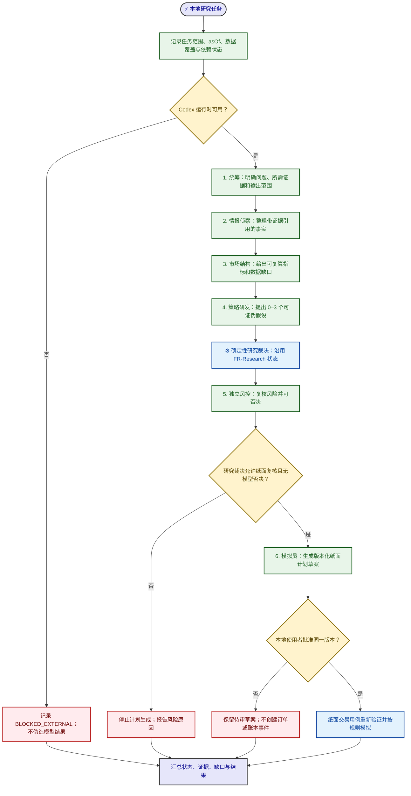

# AI 六角色研究工作流设计

> Doc ID: DOC-0008 · 目录：[DOCUMENT_INDEX](../pmo/DOCUMENT_INDEX.md)

> 状态：P02-03 设计基线，P08-01 增补 SDK 边界，P08-02 定义六角色结构化报告工作流。本文定义六个职责、输入输出、应用层验证与确定性风控边界；适配器和验证结果见下文。P04-01 裸 SDK 在 loopback 断连中请求 37 次；P08-01 为固定 Codex 0.169.0 CLI 使用独立 OpenAI-auth provider 配置，设置 `request_max_retries=0`、`stream_max_retries=0` 并关闭 WebSocket transport；断连、HTTP 429、flat SSE error 与 HTTP 401 四种 loopback 失败各实测 1 次 `/v1/responses` 请求，429 fixture 被分类为 `RATE_LIMITED`。SDK 没有请求计数/拦截接口，以上是固定版本和配置的回归证据，不推断其他认证恢复或后台调用路径；真实账户额度、认证恢复语义和远端取消效果仍为 `NOT_VERIFIED`。持久步骤状态与恢复契约见 [WORKFLOW_STATE.md](WORKFLOW_STATE.md)，DTO 见 P03-02。
>
> 六个角色是同一模型工作流中的职责划分，不是六个独立 Agent。来源时间、质量和 `DEMO_ONLY` 规则沿用[数据溯源设计](DATA_PROVENANCE.md)；系统信任边界见[系统架构](ARCHITECTURE.md)。

## Codex SDK 服务适配器（P08-01）

`src/features/ai/codex-adapter` 提供服务端 `runCodexTask`。调用方传入 prompt 与已存来源记录 ID；适配器只按 ID 从 SQLite 读取来源元数据，不读取数据库正文或账本。prompt 内容由调用方提供，后续研究工作流负责按证据边界组装。模型输出带稳定 `callId` 和来源引用，始终为 `NOT_VERIFIED`；若引用包含 `FIXTURE`，派生结果标为 `DEMO_ONLY`。

每次调用使用全新空工作目录、只读沙箱、关闭沙箱网络访问与 web search、不附加其他目录，并通过共享配置禁用 shell/exec、浏览器、应用、电脑、插件、技能搜索、hook、memory、多 Agent、auth elicitation、图像工具及 MCP。服务端 SDK 的 Codex 模型连接仍可联网；其他模型工具取数能力关闭。子进程仅接收操作系统所需的 allowlist 环境变量和本机 `CODEX_HOME`；不传递 `CODEX_API_KEY` 或 `CODEX_ACCESS_TOKEN` 环境变量。返回的流事件不包含线程 ID 或 reasoning；`response_updated` 是尚未验证的模型文本，不能视为通过结构、证据或风险门禁。

适配器为单个 Node 进程限制一个活动调用。它在首次 SDK 错误事件上取消当前 turn，并将 prompt/source IDs、输出摘要和 usage 或稳定错误码写入追加式审计链，不保存原始 prompt、模型输出或错误文本。Codex 0.169.0 禁止覆盖内置 `openai` provider 的配置，因此适配器使用临时 `stock_monitor_openai` provider，启用 Codex 本机 OpenAI 认证，设置 request/stream retry 为 0，并关闭 WebSocket fallback；它不改写用户的 `CODEX_HOME/config.toml`。这些配置字段与重试路径见 [Codex 0.169.0 provider definition](https://github.com/openai/codex/blob/rust-v0.169.0/codex-rs/model-provider-info/src/lib.rs) 和 [Responses retry handler](https://github.com/openai/codex/blob/rust-v0.169.0/codex-rs/core/src/responses_retry.rs)。断连、HTTP 429、flat SSE `error` 和 HTTP 401 的 loopback PoC 各记录 1 次 `/v1/responses` 请求，429 fixture 被分类为 `RATE_LIMITED`。SDK 未提供网络请求计数/拦截 API；该结果只验证固定 CLI 版本、provider 配置和四种本地错误样例。认证刷新、副作用请求和远端取消仍为 `NOT_VERIFIED`。`CODEX_HOME` 线程存储仍由 Codex CLI 管理；并发限制仅覆盖同一 Node 进程，跨 Next.js 与独立 Worker 的全局锁需由后续运行时集成验证。

## P08-02 结构化研究工作流

报告工作流通过一次本机 Codex 调用，按统筹、情报侦察、市场结构、策略研究、独立风控、模拟员的顺序生成结构化角色记录。六个角色是同一模型响应中的职责分段，不是独立 Agent，也没有独立模型或独立检查点。响应先通过 Zod Schema；应用代码再强制执行行情覆盖与风控否决门禁。模型只能看到本机已保存的行情条目和事件归一化摘要、来源元数据；来源原文没有存入 `source_records` 时，不会被当作已读取。

生成候选的前提是美股和日股各至少有一只证券具备 30 个不同交易日的近期日线记录；该证券记录须来自 `REAL` 或 `DELAYED` 来源，来源角色为 `AUTHORIZED_VENDOR` 或 `EXCHANGE_PRIMARY`，许可状态为 `VERIFIED`，采集时间和最新交易日均在报告前 7 天内。该门槛只表示输入覆盖足以提出未验证假设，不是策略验证、回测或盈利证据；最终候选还必须绑定到其自身证券的可用记录。任何一项不满足时，工作流报告 `NOT_VERIFIED` 并清空候选列表。模型风控 `VETO` 也会清空候选；`NO_VETO` 不等于通过，当前模拟员步骤恒为 `SKIPPED`，不生成计划或写入账本。

没有任何本机来源记录时不调用模型，工作流仍返回完整形状的 `NOT_VERIFIED` 输出，并把六个角色标为 `SKIPPED`。Codex 调用失败或结构错误保留失败状态；P08-04 负责将这些结果归档。该工作流不做外部行情/新闻抓取，不推断“无新事件”，也不声称已核实交易日、宏观日历、汇率或利率。

## P08-04 本机报告归档

报告页可以创建晨报、异常报告、日度审计或周度审计任务。请求只写入本机队列；独立 Worker 使用既有 `runCodexTask` 适配器分析已保存证据，不在报告任务中在线抓取行情或新闻。自动交易时段扫描和周期排程仍分别由 P11-03 / #71 与 P11-04 / #72 负责。

`research_reports.task_run_id` 同时是报告 ID 和任务外键，每个任务最多归档一份。内容以 `content_schema_version` 区分的结构化 JSON 保存并在写入/读取时校验；同一任务重试返回现存归档，新任务使用新 ID 生成新报告。报告页面只读 SQLite 归档，不写交易账本。

没有已保存来源时跳过模型，归档 `NOT_VERIFIED`、零候选报告；缺少任一市场的合格近期行情时，即使分析已保存事件，也强制清空候选。交易日分别由交易所静态日历快照确定，覆盖不足时显示无法核验。未来 24 小时事件只取已保存且具有来源 ID 的事件记录；事件列表仍标为 `NOT_VERIFIED`，因为本机记录不代表完整财报或宏观日历。每个候选都明确显示样本外稳定性、扣费后收益、最大回撤、成交可行性、跨环境稳健性五项状态；P09-06 评分内核已有实现，但报告尚未接入可追溯的验证结果和评分规则，因此五项仍为 `NOT_VERIFIED`，不接受模型生成分数。模拟员恒为 `SKIPPED`，研究流程不生成成交或账本写入。

## 设计决策

1. 一个研究任务只使用当前配置的同一模型，并在一个结构化响应中按统筹 → 情报侦察 → 市场结构 → 策略研发 → 独立风控复核 → 模拟员顺序返回职责记录；不并行运行角色 Agent，也不假设角色间有独立身份或独立模型保障。
2. 应用服务先校验整个响应的 Schema，再按角色检查引用的 `evidenceId`、时间戳、输入范围与允许的数据状态；无效角色输出被标为未完成并且不会进入后续候选或纸面计划，不让模型自行修补校验结果。
3. 模型只能读取应用服务整理的任务上下文和已取得证据。来源获取由应用层受限的只读适配器负责；角色步骤没有任意网络、文件系统、数据库、任务配置、账户或账本写入能力。P08 再确定运行时工具清单和调用审计。
4. 事实、推论、策略假设和证据缺口分别表达，均回链来源；验证等级、来源状态、时效和任务状态由确定性应用代码根据证据与质量规则赋值，不能由模型自评或提升。
5. “独立风控”是独立的工作流复核步骤，并非独立模型或安全执行边界。研究裁决沿用 FR-Research 状态；具体纸面计划沿用 FR-Trade 的 `PASS`、`REJECT`、`UNRESOLVED`。模型风控可否决候选或指出风险缺口，但无论是否否决都不能创建放行、改动门槛或覆盖代码结果。
6. 模拟员只生成可审阅的版本化纸面计划草案，不创建订单、模拟成交或账本事件。实际操作仍需要本地使用者对同一计划版本批准，并通过服务端确定性风险、行情有效性、资金和撮合检查；该本地批准不要求应用登录或用户账户。

## 串行流程

应用服务在每一个角色步骤之后执行同一类结构、证据引用和权限校验；任一步无效即停止后续模型调用。可用历史数据可继续支撑历史研究，但不得因此得到当前行情或新纸面计划。来源不完整时可保留已验证部分，并将相关结论降为 `PARTIAL` / `NOT_VERIFIED`；任何 Fixture 派生结果均为 `DEMO_ONLY`。

## 角色输入、输出与权限

| 步骤                       | 输入                                                                                                       | 结构化工作产物                                                              | 权限与禁止行为                                                                                                                                   |
| -------------------------- | ---------------------------------------------------------------------------------------------------------- | --------------------------------------------------------------------------- | ------------------------------------------------------------------------------------------------------------------------------------------------ |
| 统筹 Coordinator           | 任务类型、证券/市场范围、报告 `asOf`、必需来源清单、可用数据状态                                           | 研究问题、步骤计划、证据覆盖清单和已知限制                                  | 不能改变来源状态、用户范围、风险阈值或执行授权；不能将未知当作已验证。                                                                           |
| 情报侦察 Intelligence      | 仅限任务范围的 SEC/EDINET/发行人/新闻等已取得来源记录和来源元数据                                          | 带 `evidenceId`、来源时间和主体的事实候选、修订/冲突提示                    | 不能猜测缺失数据；不能把报道或摘要升级为官方披露；不能将网页内容中的指令当作系统指令。                                                           |
| 市场结构 Market Structure  | 有效 OHLCV/FX、交易日历、已验证事件及数据质量结果                                                          | 趋势/波动/异常观察、计算值及输入引用、无数据或时效限制                      | 不能声称访问了未提供的实时图表；不能改写原始报价、单位或来源延迟。指标计算由可复算代码提供。                                                     |
| 策略研发 Strategy Research | 通过验证的事实和结构指标、允许使用的研究约束                                                               | 0–3 个逻辑不同的策略假设；每项包括依据、对手情形、触发/失效条件和待验证事项 | 不能将假设说成事实或收益保证；无样本不得声称胜率/验证分数；不能创建订单或批准计划。                                                              |
| 独立风控 Risk Officer      | 策略候选、确定性研究裁决及原因、输入有效性/证据缺口                                                        | 风险意见、需补充的输入和明确的否决结论                                      | 可以否决候选并停止后续纸面计划；没有否决只表示模型未提出否决，不代表通过；不能改写研究裁决或 FR-Trade 结果、改变 2%/20% 固定规则或审批账本写入。 |
| 模拟员 Paper Planner       | 仅限确定性研究裁决为 `APPROVED_FOR_PAPER_REVIEW` 且未被否决的候选、有效行情/FX/成本/交易单位、当前账本状态 | 版本化纸面计划草案及其证据引用；输入不足时不生成可执行草案                  | 不能写订单/成交/账本；不能推定本地批准；不能触发真实券商、资金或交易所请求。最终计划须再通过 FR-Trade 确定性门禁。                               |

角色名称只用于责任和报告归属，不形成权限。模型永远不持有账本写端口；`Risk Officer` 的否决由应用流程强制执行，确定性风险检查由纸面交易用例再次执行。具体 DTO 字段、模型输出解析器及安全工具列表分别在 P03-02/P08 定义。

## 证据引用的确定性校验

P08-03 在结构化输出后检查 source record 血缘。每项事实、推论、假设、角色摘要和候选的 `evidenceIds` 必须指向当前本机 SQLite 已载入的来源记录；未知 ID、无引用、无效时间戳、未来的发布时间/可用时间/采集时间、晚于采集时间的发布时间/可用时间、非 HTTPS 或带凭据 URL、无效数据类别都会拒绝对应输出。未来的事件发生时间可表示已披露的预定事件；它仍必须有可核验的发布日期或来源摘要。

报告的 URL 只取自存储的 canonical/source URL，模型输出不包含 URL 字段。没有网页 URL 的本机材料（例如用户导入 CSV）可按来源编号引用，但来源覆盖标为 `UNKNOWN` 并明确显示无网页链接；URL 不得由模型补造。行情引用附带市场推导的报价币种与每股/股数单位；报告中的数值、币种和单位必须能在引用的来源摘要中找到对应词项。策略候选还必须引用该市场、该证券满足数据等级、许可、近期性与 30 个交易日覆盖门槛的行情记录。

不通过的条目从报告正文/候选中移除，并以 `evidenceValidation.rejections` 保存输出位置、source ID 和原因码；校验失败的风险意见按否决处理。`evidenceValidation.status = PASSED` 仅表示这些确定性引用检查通过，不代表事实语义已被证明。数字与单位检查是词项匹配，不能识别所有语义错配；AI 报告始终保持 `NOT_VERIFIED`（Fixture 仍为 `DEMO_ONLY`），不得据此升级验证或执行模拟交易。

## 状态与失败关闭

沿用 [FR-Research 状态契约](../requirements/FR_RESEARCH.md)，任务执行、报告验证、数据状态、来源状态和扫描结果彼此独立，不新增状态码。

| 情况                                                  | 任务/报告处理                                                                    | 后续步骤与纸面交易限制                                                                           |
| ----------------------------------------------------- | -------------------------------------------------------------------------------- | ------------------------------------------------------------------------------------------------ |
| Codex 凭据、额度或服务不可用                          | 任务记录 `BLOCKED_EXTERNAL` 或真实失败原因；没有可用模型输出时不声称报告完成     | 不用缓存答案或 Fixture 伪装成功；保留本地材料可读。                                              |
| 必需行情/来源缺失、过期、冲突或主体映射不可靠         | 对受影响的事实和报告标 `NOT_VERIFIED`，存在独立有效部分时用 `PARTIAL` 并列出缺口 | 仍可执行不依赖缺失字段的研究步骤；停止依赖这些输入的当前信号和模拟计划，不把空数据解释为无事件。 |
| 仅有有效历史数据                                      | 数据和派生结果标 `HISTORICAL`；报告清楚列出期间                                  | 可做可复算历史研究；禁止生成当前报价、实时触发或新模拟成交。                                     |
| 任一输入或上游步骤来自 Fixture                        | 所有下游报告、图表、策略评估及计划展示保持 `DEMO_ONLY`                           | 与真实/历史结果隔离；不得进入正式账本。                                                          |
| 结构校验、证据 ID 或权限校验失败                      | 该步骤失败并记录可审计错误；报告不可被标为 `VERIFIED`                            | 不调用下一模型步骤、不产生副作用；不要求模型自行判定错误已经修复。                               |
| 适用的确定性研究/交易裁决拒绝或未解决，或模型风控否决 | 报告列出代码裁决、模型否决和风险依据的不同来源                                   | 模拟员步骤跳过；无纸面计划、订单或账本写入。                                                     |
| 没有满足门槛的策略                                    | 可在证据完整时正常报告零个候选                                                   | 不为凑数生成候选、计划或策略评分。                                                               |

任务最终使用现有 `PENDING`、`RUNNING`、`DONE`、`FAILED`、`BLOCKED_EXTERNAL`、`SKIPPED`；报告使用 `VERIFIED`、`PARTIAL`、`NOT_VERIFIED`、`DEMO_ONLY`；风险裁决按研究或交易契约使用现有结果，不新增状态码。具体计划的交易门禁沿用 FR-Trade 的 `PASS`、`REJECT`、`UNRESOLVED`。角色步骤的进度记录复用任务状态语义，P03-05 决定持久化方式。报告进入 `DONE` 不代表候选获批或产生模拟成交。

## 审计与后续实现

每个角色步骤需能关联任务、固定角色顺序、输入 evidence/source ID、流程/schema 版本、校验结果、结构化输出和失败原因；不得记录认证凭据、隐藏推理或完整模型上下文。步骤检查点和崩溃恢复遵循 [WORKFLOW_STATE.md](WORKFLOW_STATE.md)，数据库由 [DB_SCHEMA.md](DB_SCHEMA.md) 描述，API/DTO 见 [API_CONTRACTS.md](API_CONTRACTS.md)，运行时调用与工具边界由 P04/P08 实测。完整来源血缘遵循 [DATA_PROVENANCE.md](DATA_PROVENANCE.md)，纸面计划版本批准和交易边界遵循 [FR-Trade](../requirements/FR_TRADE.md)。

| 需求                                                      | 本文约束                                                         | 后续实现/验收                                               |
| --------------------------------------------------------- | ---------------------------------------------------------------- | ----------------------------------------------------------- |
| RQ-009、FR-Research-008、AC-RES-020                       | 六项职责为单模型串行步骤；按角色验证输出，不能由模型直接访问账本 | P03-02 DTO；P08-02 工作流和 P08-05 权限测试；P12-03/05 回归 |
| RQ-019/020、FR-Trade-001/002、AC-TRD-004                  | 风险意见可否决但不能替代确定性裁决；本地批准绑定不可变计划版本   | P03-02/03；P10 交易用例；P12-01/02 验证                     |
| RQ-011/028、FR-Research-011、FR-Trade-013、AC-RES-010/017 | 外部不可用和 Fixture 逐级降级；Fixture 结果隔离为 `DEMO_ONLY`    | P04/P07/P08 运行条件；P12-03/04 集成与审计                  |

本文不决定供应商、Codex 模型 ID、工具 SDK、API/DTO 字段或六角色提示词内容；分别留给 P04、P03-02、P08-01/02 通过实际可用性、安全边界和样本验证后确定。

## 修订记录

- 2026-11-16（P08-01 / #53）：补充 Codex SDK 适配器运行边界与 0.169.0 provider 重试预算的 loopback 验证；真实认证、额度和远端取消仍未验证。
- 2026-11-18（P08-02 / #54）：明确单次结构化 Codex 响应的六角色记录、已保存证据边界、双市场最低行情覆盖、失败关闭及无行情时零候选契约。
- 2026-11-19（P08-03 / #55）：补充本机来源 ID、时间、URL、数据类别、数字/币种/单位和证券行情关联校验；该校验不是语义事实核验。
- 2026-11-19（P08-04 / #56）：补充本机 Worker 报告任务、版本化 JSON 归档、任务重试幂等、五维未验证状态及行情/日历缺口的零候选行为。
