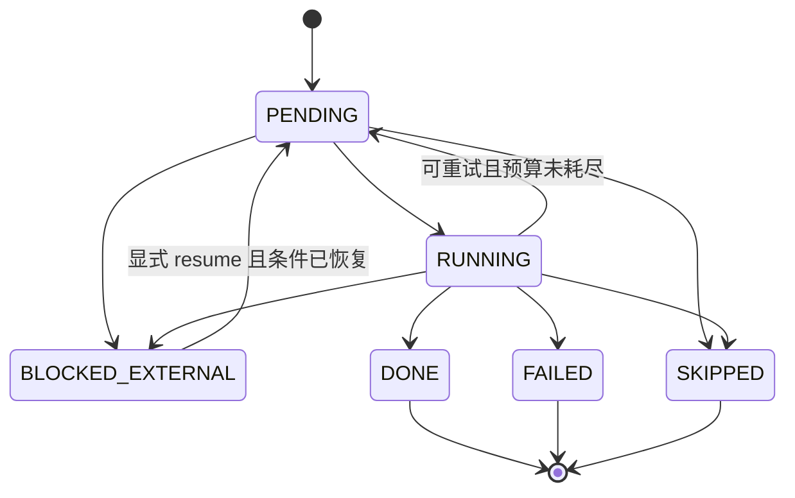
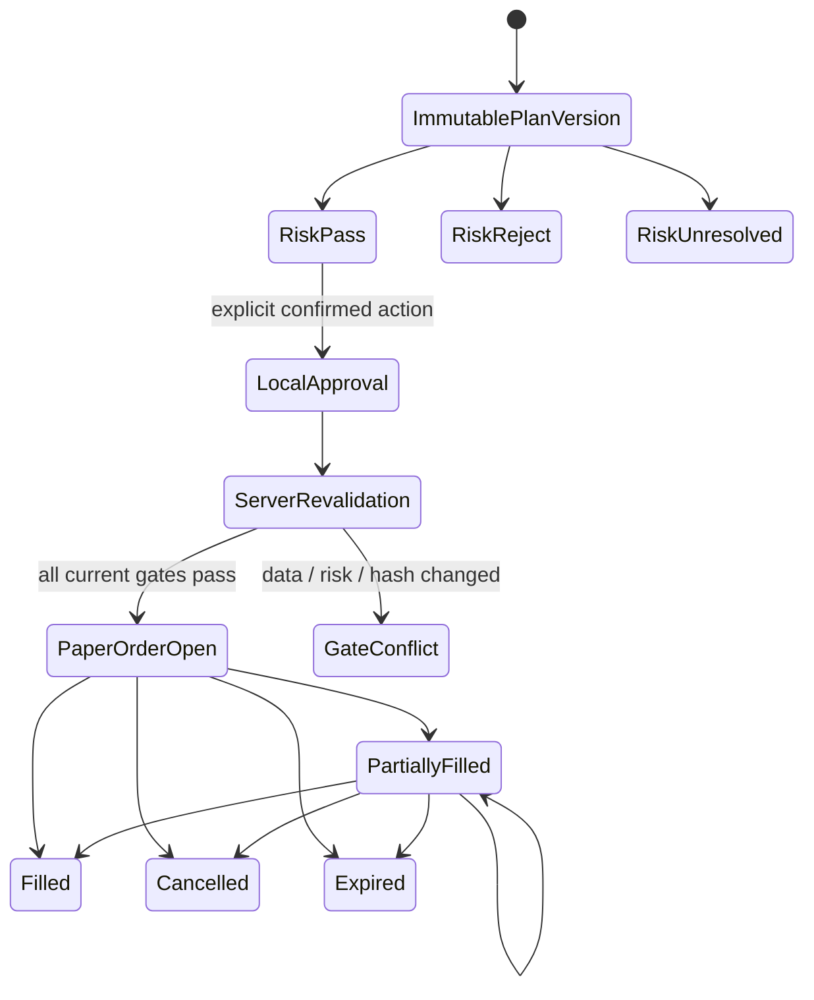

# API、DTO 与状态机契约

> Doc ID: DOC-0009 · 目录：[DOCUMENT_INDEX](../pmo/DOCUMENT_INDEX.md)

> 状态：P03-02 设计基线；P05-03 / #39 提供 JSON 请求解析、统一响应与本地来源校验；P06-06 / #47 已实现 loopback 保护的 SQLite 备份 Route Handler。其余 V1 路由与生产任务运行时仍待后续阶段实现。
>
> 上位契约：[系统架构](ARCHITECTURE.md)、[威胁模型](THREAT_MODEL.md)、[AI 工作流](AI_WORKFLOW.md)、[数据溯源](DATA_PROVENANCE.md)、[DB Schema](DB_SCHEMA.md)、[研究需求](../requirements/FR_RESEARCH.md)、[纸面交易需求](../requirements/FR_TRADE.md)、[非功能需求](../requirements/NFR.md)。

## 边界与共同规则

- API 仅供绑定到 `127.0.0.1` 的本地 UI 使用，统一前缀 `/api/v1`，JSON 编码；不提供远端客户端契约、产品登录/用户管理、券商账户连接或真实下单 API。
- 浏览器只提交命令和筛选条件。Route Handler 对每个请求执行严格边界验证，再调用服务端用例；风控、当前行情/FX 复核、批准和账本权限都由服务端确定性代码判定，不能信任客户端状态、AI 输出或隐藏按钮。
- 禁用 CORS。每个请求校验 URL 与 `Host` 都是 loopback 且端口一致；框架把 URL hostname 规范化为 `localhost` 时，仍要求传入 `Host` 和变更请求的 `Origin` 匹配。Origin 缺失或为 `null` 时按威胁模型校验 `Referer`，两者均不可验证则拒绝。拒绝 DNS rebinding/非预期 Host；不要把未经验证的 `Forwarded` / `X-Forwarded-Host` 当作可信来源。V1 不用 Cookie 或 bearer token 建立产品身份。
- GET 仅查询，不触发供应商刷新、任务创建或账本副作用。POST 命令不得由预取、渲染、超链接导航或请求重试隐式触发；任务/账户初始化/计划版本/批准/模拟订单等命令要求 UUIDv4 `Idempotency-Key`。键按操作范围唯一；相同键与相同规范化输入重放原结果，相同键与不同输入返回 `409 IDEMPOTENCY_KEY_REUSED`。
- JSON 请求体上限为 64 KiB（当前命令 DTO 不接受行情序列或文章原文），在读取前校验大小并要求 `Content-Type: application/json`。外部/模型输出使用独立严格 Schema；未知键、类型错误、超长字符串/数组和非法枚举拒绝。验证错误只返回字段路径与错误码，不回显原始输入、模型原文、秘密或堆栈。
- 各边界通过 Zod Schema 校验；请求 DTO 类型从 Schema 推导，禁止另写一个可能漂移的请求类型。服务端输出使用 DTO serializer/Schema 测试，领域实体和 DB 行不直接返回给浏览器。AI schema 不允许写 `verificationLevel`、`sourceStatus`、`riskVerdict`、账本余额或成交状态等确定性字段；应用层解析后检查 evidence ID 存在且属于本次输入，再赋值验证状态。
- 所有 API 响应使用 `Cache-Control: no-store`。响应头 `X-Request-Id` 由服务端生成；不得信任或回显调用方提供的 request ID。日志只记录该 ID、路由、耗时、业务码和脱敏的来源状态。

## 通用 DTO 与精度

成功响应采用 `{ "data": ..., "meta": { "requestId": "..." } }`。分页响应另含 `meta.nextCursor`；没有下一页时为 `null`。业务数据源不完整时仍须在 DTO 中显式携带来源/验证/结果状态，不能只给空数组。

| 值         | JSON 约定                                                                                                                                                      |
| ---------- | -------------------------------------------------------------------------------------------------------------------------------------------------------------- |
| 稳定 ID    | 服务端生成的 UUID 字符串；不接受客户端指定的主键。                                                                                                             |
| 绝对时间   | RFC 3339 UTC 字符串，保留毫秒并以 `Z` 结尾；未带 offset 的时间字符串拒绝。                                                                                     |
| 市场业务日 | `YYYY-MM-DD` 加 IANA timezone 字段；不得用本机时区替代市场时区。当地日期语义见 [DOC-0038](DOMAIN_PRIMITIVES.md)，不代表实际交易日。                                                                                               |
| 货币       | ISO 货币码字段与金额分开。金额用十进制字符串表达最小单位，例如 `amountMinor: "1000000"`，另带 `scale`；不得用 JS `number` / JSON 浮点金额；V1 JPY=0/USD=2，最小单位见 [DOC-0038](DOMAIN_PRIMITIVES.md)。                    |
| 价格与 FX  | `{ mantissa: "12345", scale: 2, currency: "JPY" }`；FX 单位按 quote per base 解释，见 [DOC-0038](DOMAIN_PRIMITIVES.md)；汇率另带明确 `baseCurrency` / `quoteCurrency`。精确整数用字符串，`scale` 等受界限的小整数用 JSON integer。 |
| 股数       | `quantityShares` 用十进制整数字符串；展示交易单位与方向必须分字段。                                                                                            |
| 证据时间   | `publishedAt`、`occurredAt`、`availableAt`、`collectedAt` 与行情 `marketAt` 分列；不确定值为 `null` 并附原因，不能相互填充。                                   |
| 状态       | 保留 FR-Research/FR-Trade 中的稳定英文状态码；简体中文释义由客户端字典呈现，不能翻译后再发回 API。                                                             |

分页使用不透明 URL-safe cursor，不使用大 offset。排序必须全序且稳定（例如 `(createdAt, id)` 或 `(barStart, instrumentId)`）；cursor 包含版本和筛选条件指纹，跨筛选复用、无效编码、未知版本或过期上下文返回 `400 INVALID_CURSOR`。`limit` 默认 50，允许 1–100；不合法值不静默裁剪。cursor 不是授权凭证，也不含秘密。

## V1 路由目录

| 方法与路径                                                                              | 用途 / 成功状态                                                                                                                                                                              | 约束                                                                                                                                                                       |
| --------------------------------------------------------------------------------------- | -------------------------------------------------------------------------------------------------------------------------------------------------------------------------------------------- | -------------------------------------------------------------------------------------------------------------------------------------------------------------------------- |
| `GET /api/v1/market-sessions?market=&date=`                                             | 返回交易日历版本、当地日期/时段、时区、来源和状态。                                                                                                                                          | 查询失败或日历未知时显式 `CALENDAR_UNAVAILABLE` / `UNKNOWN`；不能假定开市。                                                                                                |
| `GET /api/v1/instruments?market=&query=&cursor=&limit=`                                 | 分页查找已知证券及分类/识别状态。                                                                                                                                                            | 搜索不得自动添加“当前仍存续”过滤以供回测复用；有效区间由服务端返回。                                                                                                       |
| `GET /api/v1/instruments/{instrumentId}/quotes`                                         | 返回已持久化的报价观察及来源/市场时间/数据类别/新鲜度。                                                                                                                                      | 无报价也返回明确状态/原因；不能伪装实时或返回旧值但不标记。GET 不拉取外部行情。                                                                                            |
| `GET /api/v1/instruments/{instrumentId}/bars?interval=&from=&to=&cursor=&limit=`        | 返回来源可追溯的 OHLCV bar。                                                                                                                                                                 | UTC 起止合法、区间上限受控；每个结果含调整口径、来源、时间与数据类别。                                                                                                     |
| `POST /api/v1/research-runs`                                                            | 创建晨报/研究/异常扫描等持久任务，返回 `202 Accepted` 和 `TaskDto`。                                                                                                                         | `Idempotency-Key` 必填；无凭据或来源离线由真实任务状态表达，不伪造成功报告。                                                                                               |
| `GET /api/v1/tasks?cursor=&limit=` / `GET /api/v1/tasks/{taskId}`                       | 查询任务列表或任务状态。                                                                                                                                                                     | `DONE` 只表示执行完成，不表示 `VERIFIED` 或有策略候选。                                                                                                                    |
| `POST /api/v1/tasks/{taskId}/resume`                                                    | 显式恢复一个外部条件已修复的任务，返回 `202 Accepted` 和同一 `TaskDto`。                                                                                                                     | `Idempotency-Key` 必填；只接受 `BLOCKED_EXTERNAL` 且仍有总尝试预算的任务，原任务输入/hash 不变，服务端先复核前置条件并原子转回 `PENDING`；不能通过此路由重试终态 `FAILED`。 |
| `GET /api/v1/reports?type=&from=&to=&cursor=&limit=` / `GET /api/v1/reports/{reportId}` | 查询不可变研究报告。                                                                                                                                                                         | DTO 保留 `executionStatus`、`verificationLevel`、`resultCode`、`sourceCoverage`、`dataClass`、`limitations`、as-of 和策略证据；策略可为 0–3 项。                           |
| `POST /api/v1/backtests` / `GET /api/v1/backtests/{backtestRunId}`                      | POST 返回 `202 Accepted` 并创建历史回测任务；GET 返回不可变结果。输入引用策略版本、证券池、历史窗口和 P03-04 验证方案；`Idempotency-Key` 必填。响应保留运行状态、输入 hash、覆盖与验证等级。 | 服务器解析实际历史数据、点时宇宙、费用/FX 和规则版本；无固定“几十年”覆盖承诺，覆盖不够则 `NOT_VERIFIED`。不按最高胜率自动挑选或批准“赢家”；指标、样本外和评分契约见 [BACKTEST_ENGINE.md](BACKTEST_ENGINE.md)。 |
| `POST /api/v1/paper-account/initialize`                                                 | 显式初始化本地模拟账户，返回 `201 Created` 和账户 DTO。                                                                                                                                      | `Idempotency-Key` 和 `confirmed: true` 必填；固定 1,000,000 JPY 由服务端写入，不接受金额/币种参数；已有账本返回冲突，不重置。                                              |
| `GET /api/v1/paper-account` / `GET /api/v1/paper-account/ledger?cursor=&limit=`         | 查询账户是否初始化、可核验权益状态及追加账本事件。                                                                                                                                           | 未初始化必须返回 `NOT_INITIALIZED`，不推算余额、持仓或盈亏。账本游标按唯一序号稳定排序。                                                                                   |
| `POST /api/v1/paper-plans` / `POST /api/v1/paper-plans/{planId}/versions`               | 从候选创建纸面计划，或为既有计划创建新的不可变版本，返回 `201 Created`。                                                                                                                     | `Idempotency-Key` 必填；只追加新版本，不提供 `PATCH` 覆盖已评估版本。字段/数值边界沿用 FR-Trade 与 P03-03。                                                                |
| `POST /api/v1/paper-plans/{planId}/versions/{versionId}/approvals`                      | 对精确不可变版本产生本地批准记录，返回 `201 Created`。                                                                                                                                       | `Idempotency-Key`、`planHash`、`riskDecisionId` 和 `confirmed: true` 必填；服务器重读版本并验证 hash、同版本 `PASS`、未失效行情/FX、权益/回撤与现金条件。不接受 `userId`。 |
| `POST /api/v1/paper-plans/{planId}/versions/{versionId}/paper-orders`                   | 创建本地模拟订单，返回 `201 Created` 与持久化订单 DTO。                                                                                                                                      | 仅纸面撮合用例；要求同版有效批准和服务器复核。无合格行情时不成交；绝不调用券商/交易所。                                                                                    |
| `GET /api/v1/paper-orders/{orderId}`                                                    | 查询本地模拟订单及状态事件。                                                                                                                                                                 | 订单均明确 `PAPER`；不得出现可配置 broker URL、账户号或真实订单 ID。                                                                                                       |
| `POST /api/v1/backup`                                                                  | 对当前本机 SQLite 创建一致性快照，返回 `200 OK` 和备份路径、Schema 版本、文件长度、SHA-256 与创建时刻。                                                                                      | 无请求体；仅 loopback 同源；服务端使用应用数据路径并分配唯一输出目录，不覆盖数据库或已有备份；不读取或返回凭据。失败为 `BACKUP_FAILED`。 |

未列出的写接口不因便利而开放；尤其没有通用 SQL、provider URL、运行时设置、密钥、账户流水更新/删除、策略状态覆盖或真实交易端点。后续用例若需要新命令，须增加具名服务端用例并满足相同边界。

行情查询只返回已取得并持久化的最新观察和完整时效/授权状态；V1 不承诺 WebSocket/SSE 实时推送。只有 P04/P07 验证供应商市场覆盖、许可、实时权限与时间戳后，UI 才可显示实时标记；轮询/缓存结果不得自行升格为实时。

### 命令与 DTO 示例

启动研究只提交命令输入，不提交状态、分数或 AI 输出：

```json
{
  "runType": "MORNING",
  "markets": ["TSE", "NYSE", "NASDAQ"],
  "asOf": "2026-11-15T12:00:00.000Z"
}
```

```json
{
  "data": {
    "taskId": "8f0e3e0b-0000-4000-8000-000000000001",
    "runType": "MORNING",
    "executionStatus": "PENDING",
    "submittedAt": "2026-11-15T12:00:00.000Z"
  },
  "meta": { "requestId": "c074584c-0000-4000-8000-000000000001" }
}
```

响应 DTO 的 `executionStatus`、报告验证等级和来源覆盖由服务端产生。不得接受上例之外的客户端键（例如 `verificationLevel: "VERIFIED"`、`riskVerdict: "PASS"` 或 `accountBalance`）。

## HTTP 与业务错误

错误响应统一为：

```json
{
  "error": {
    "code": "VALIDATION_FAILED",
    "message": "请求参数无效",
    "details": [{ "path": "limit", "code": "TOO_BIG" }],
    "retryable": false
  },
  "requestId": "c074584c-0000-4000-8000-000000000001"
}
```

| HTTP  | 稳定业务码                                                                                                                | 使用场景 / 客户端处理                                                                          |
| ----- | ------------------------------------------------------------------------------------------------------------------------- | ---------------------------------------------------------------------------------------------- |
| `400` | `VALIDATION_FAILED`、`INVALID_CURSOR`、`INVALID_JSON`                                                                     | 请求格式/字段/分页游标无效；按字段提示修正，不重试原请求。                                     |
| `403` | `LOCAL_ORIGIN_REQUIRED`                                                                                                   | Host/Origin/Referer 不匹配或状态变更请求缺少可验证来源；拒绝操作，不提供登录绕过。             |
| `404` | `RESOURCE_NOT_FOUND`                                                                                                      | 稳定 ID 不存在；不返回内部文件/SQL 路径。                                                      |
| `409` | `STATE_CONFLICT`、`IDEMPOTENCY_KEY_REUSED`、`TASK_NOT_RESUMABLE`、`PLAN_VERSION_MISMATCH`、`ACCOUNT_ALREADY_INITIALIZED`、`PLAN_NOT_APPROVABLE` | 当前状态、剩余尝试预算、hash、批准、幂等键载荷或资源版本冲突；返回稳定业务码和可重新读取的资源 ID。 |
| `413` | `REQUEST_TOO_LARGE`                                                                                                       | JSON body 超过路由上限；在解析/模型调用前拒绝。                                                |
| `415` | `UNSUPPORTED_MEDIA_TYPE`                                                                                                  | 变更接口不是 JSON。                                                                            |
| `429` | `LOCAL_RATE_LIMITED`                                                                                                      | 本地工作队列或查询保护限流；有界等待后可重试，返回整数 `Retry-After`。不得透传供应商响应正文。 |
| `503` | `LOCAL_STORAGE_BUSY`、`LOCAL_SERVICE_UNAVAILABLE`                                                                         | SQLite/Worker 本机服务暂时不可用；允许时返回 `retryable: true` 和有限重试提示。                |
| `500` | `INTERNAL_ERROR`、`BACKUP_FAILED`                                                                                          | 未预期错误或本机备份失败；只返回 requestId 与稳定错误文案，不回显堆栈、SQL、文件路径或外部内容。                         |

无登录产品不返回 `401`/`UNAUTHORIZED`。已接受的异步任务即使之后遇到断网、凭据或供应商不可用，创建请求仍为 `202`；`TaskDto.executionStatus` 最终如实进入 `BLOCKED_EXTERNAL`/`FAILED`，并通过报告来源覆盖给出原因。读取一个已保存但过期/不完整的报价，是 `200` 加显式 `STALE`/`PARTIAL_COVERAGE` DTO；本地 API 或存储本身不可用才返回 `503`。`NO_NEW_EVENTS` 只能来自满足 FR-Research 完整覆盖与有效 SLA 的扫描，不能由 API 层猜定。

## 状态机

### 持久任务



任务枚举严格沿用 FR-Research，不新增 `CANCELLED` / `RETRYING` 等状态。当前任务记录不可由客户端直接 PATCH 状态；相同幂等键与相同输入返回原 task，键相同而规范化输入 hash 不同返回 `409 IDEMPOTENCY_KEY_REUSED`。瞬时错误在有限预算内回到 `PENDING`；凭据、授权、费用、权限等外部阻断不自动重试，只能由 `POST /tasks/{taskId}/resume` 在服务端确认前置条件恢复后对原任务显式恢复，不重置该任务的总尝试预算。预算耗尽时 `TASK_NOT_RESUMABLE`，须用新幂等键创建并关联新任务。终态 `FAILED` 的新运行须使用新幂等键。HTTP 连接断开不取消已持久化任务。

`TaskDto` 至少返回 `taskId`、`runType`、`executionStatus`、`resultCode`、`attemptCount`、`nextAttemptAt`、`lastCompletedStep`、`submittedAt`、`startedAt`、`finishedAt`、`sourceCoverage` 和 `errorCode`；不适用的时间、步骤或错误字段为 `null`。DTO 不含凭据、完整提示词、隐藏推理或未校验模型原文。

### 研究结果与证据状态

- `executionStatus` 表示任务执行；`verificationLevel` (`VERIFIED` / `PARTIAL` / `NOT_VERIFIED` / `DEMO_ONLY`)、`dataClass`、来源状态、时效和 `resultCode` 是互不替代的字段。
- 报告及其 evidence link 创建后不可原位编辑/提升等级。新证据或修订应创建新研究运行/新报告并保留来源修订关系；`DONE` 任务可以产生 `NOT_VERIFIED` 报告或无报告的阻断结果。
- AI 输出是严格校验的提案。程序解析并核实本次输入范围、证据 ID 和字段上限之后，另行生成报告状态及确定性裁决；未知键或引用缺失直接失败关闭，不请求模型自行授予权限。
- `DEMO_ONLY` 任一 Fixture 上游不得在后续 DTO 中被降级为 `HISTORICAL` / `REAL`，不能进入批准或 paper-order 命令。

### 纸面计划、批准与模拟订单



计划内容本身不可变；编辑创建新版本，旧版本的风险决策和批准不能授权新版本。`RiskPass` 只表示所引用输入通过确定性门槛，不代表本地批准；审批是没有用户身份字段的追加本机操作记录。订单创建前服务端重新验证同版 hash/批准、当前有效行情/FX/成本、账本权益和所有固定风险门禁。当前输入不再可用时返回冲突且不创建订单/流水。

订单 V1 仅用于本地模拟：`OPEN` 可转 `PARTIALLY_FILLED`、`FILLED`、`CANCELLED`、`EXPIRED`；`PARTIALLY_FILLED` 可继续部分成交、完成、取消剩余量或到期；`FILLED` / `CANCELLED` / `EXPIRED` 是终态。拒绝新建订单作为带业务码的 API 结果，不伪造一个已接受订单。成交、订单事件、现金/持仓 postings 与 ledger event 由纸面交易用例在同一短事务中幂等提交；无合格行情不创建 fill。P10 细化订单撮合/部分成交/撤单时序与边界 AC。

## 需求映射与后续边界

| 契约                             | 需求 / 后续落地                                                                                           |
| -------------------------------- | --------------------------------------------------------------------------------------------------------- |
| 本地同源、服务端校验、无产品身份 | RQ-001/025、NFR-001/008、AC-NFR-002/012/022；P05 路由入口、P06 页面、P12-05 安全验证。                    |
| 报告/证据 DTO 与异步任务         | FR-Research-006/010/011、AC-RES-010/011/017/022；[SCHEDULER](SCHEDULER.md)、[WORKFLOW_STATE](WORKFLOW_STATE.md)、P08 研究运行、P12-02/03。 |
| 版本化纸面批准和仅模拟订单       | FR-Trade-001/002/008/009/010、AC-TRD-004/013/014；P03-03 风控、P05 仓储、P10 模拟交易、P12-01/02。        |
| 定点数、时间、来源与不可验证状态 | FR-Trade-011/013、NFR-009/010/011、AC-NFR-013–017；DB_SCHEMA、P03-04 回测契约、P07 数据适配器、P09 实现。 |

本契约定义接口和状态边界，不接通 AI/行情。P06-06 / #47 仅实现并测试 `POST /api/v1/backup`；其余路由与实际响应体/状态迁移测试依各阶段落地，汇总验收见 P12。数据供应商由 P04/P07 核验；不因公开 API 存在就把付费、授权不清或未点时数据当作 V1 可用来源。
