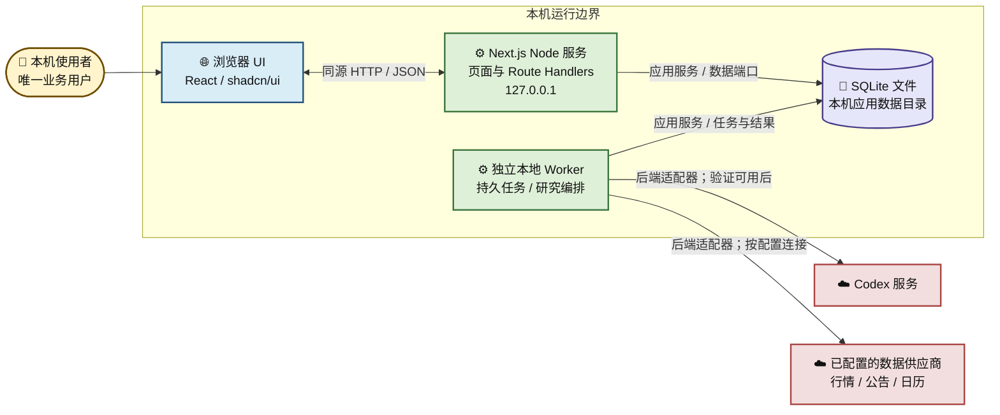
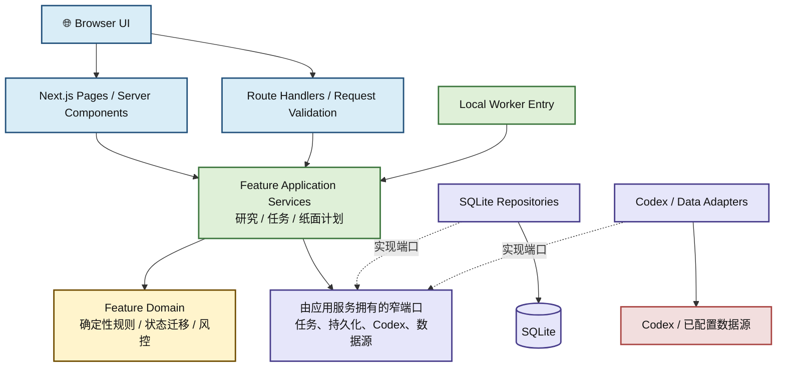

# V1 系统架构

> 状态：P02-01/P02-04 架构基线；P05 已接入本机 SQLite/Drizzle，P11-01 已接入持久任务队列和独立 Node Worker。本文不表示 Codex、实时市场数据或研究任务处理器已在产品中接通；数据与证据契约见 P02-02，AI 工作流与角色权限见 P02-03，Worker 的运行行为由 P11-01 实现并持续由 P12 验证。
>
> 需求入口：[PRD](../requirements/PRD.md)、[非功能需求](../requirements/NFR.md)、[需求追踪矩阵](../requirements/TRACEABILITY.md)、[UI 设计](UI_DESIGN.md)。

## 范围与现状

V1 是单机、单一业务使用者的美日股研究和纸面模拟工具。首次使用不要求应用登录、注册、用户管理或云身份；UI 设计基线采用 shadcn/ui，组件在 P06 UI 实现阶段接入，当前最小主页尚未使用组件库。系统不连接券商，不提供真实下单、云同步、遥测或付费结算。

仓库包含 Next.js App Router、本机 SQLite/Drizzle 基础设施和 Worker 任务队列。`pnpm worker` 独立运行队列协调器，`scripts/autopilot.ts` 与 `scripts/context.ts` 仍是开发执行器，不是产品任务处理器，也不读取市场数据。P11-01 尚未注册研究任务处理器；下文其他业务容器仍描述目标边界。

## 系统上下文与运行拓扑

浏览器只访问本机同源页面和 API。Next.js 服务负责页面/API 适配；独立 Worker 在浏览器关闭时仍可处理已持久化任务。两者通过服务端应用服务和 SQLite 适配器访问本地数据。只有配置并验证可用的服务才允许从后端连接；外部内容始终是不可信输入。



颜色只区分容器类型；数据状态用明确文字和状态码表示。开发 Autopilot 单独运行于 `scripts/`，其 Codex 授权和工作区权限不自动授予产品 Worker。

## 模块分层



目标目录按真实 feature 建立，未使用前不创建空壳：

```text
src/app/                         Next 页面和 HTTP Route Handlers
src/features/<feature>/
  application/                   用例编排、输入/结果类型与所需端口
  domain/                        纯业务规则和状态迁移
  infrastructure/                该 feature 的持久化/外部适配器
src/worker/                      独立 Worker 入口与调度组合
src/server/                      服务端配置和依赖组合根
```

| 层                                                | 职责                                                                   | 禁止依赖/行为                                                      |
| ------------------------------------------------- | ---------------------------------------------------------------------- | ------------------------------------------------------------------ |
| Presentation（`src/app`）                         | 渲染页面、解析同源 HTTP 请求、验证边界输入、映射响应/错误              | 不导入 SQLite、Codex SDK、密钥或领域写入器；不把权限判断留给浏览器 |
| Feature Application（`features/*/application`）   | 编排研究、任务和纸面计划用例；执行授权/验证门；调用本 feature 所需端口 | 不依赖 Next.js UI；不把模型输出当成已验证事实或风险裁决            |
| Feature Domain（`features/*/domain`）             | 纯计算、风险规则、账本不变量、报告状态迁移                             | 不做网络、文件、数据库或模型调用；不依赖 React/Next.js             |
| Infrastructure（`features/*/infrastructure`）     | 实现 SQLite、Codex 与数据来源端口；统一来源状态和 I/O 错误             | 不绕过 Application/Domain 直接生成风险通过、模拟成交或账本金额     |
| Runtime composition（`src/worker`, `src/server`） | 分别组合 Web 和 Worker 运行时；为每种入口只注入所需能力                | 不共享开发 Autopilot 的任务授权，不让 Worker 依赖浏览器生命周期    |

端口由使用它的 Application 层定义并保持窄接口；只有出现真实调用方/实现时才增加抽象。跨 feature 共用代码只在已有重复和稳定契约后抽取。

## 同步与异步接口

| 调用边界                           | 交互方式                                                  | 契约                                                                             |
| ---------------------------------- | --------------------------------------------------------- | -------------------------------------------------------------------------------- |
| Browser → Next.js                  | 同源 HTTP 请求/响应；页面可同步等待本地查询或用户命令结果 | 浏览器只提交结构化输入；页面不等待 Codex 或外部行情任务完成                      |
| Next.js → Application              | 服务端异步调用                                            | Route Handler 验证请求后调用用例；精确 API/DTO、业务码和取消语义由 P03-02 定义   |
| Worker → Application               | 后台异步调用                                              | 从 SQLite 认领已持久化任务，执行后保存状态/结果；不依赖浏览器定时器              |
| Application → Domain               | 同步、确定性计算                                          | 无 I/O；风险计算、规则和状态迁移可在无网状态运行                                 |
| Application → Infrastructure ports | 异步 I/O                                                  | 本地数据库事务和外部请求均有明确超时/失败结果；不以空结果掩盖故障                |
| Codex / 数据源 → Application       | 异步、不可信输入                                          | 适配器保留来源/时间/质量状态；结构验证后作为提案或证据输入，不能直接调用账本端口 |

长时间研究或监测请求先持久化任务并返回任务标识，结果通过后续查询读取；任务状态沿用需求中的 `PENDING`、`RUNNING`、`DONE`、`FAILED`、`BLOCKED_EXTERNAL`、`SKIPPED`。具体任务表、原子认领、重试和 API 路由由 P03-01/P03-02/P03-05 细化。V1 不引入远程消息队列。

## 数据写入与信任边界

- SQLite 文件位于本机应用数据目录，脱离 Git 仓库和工作区：Windows 默认 `%LOCALAPPDATA%\stock-monitor\database.sqlite`，macOS 默认 `~/Library/Application Support/stock-monitor/database.sqlite`，Linux 默认 `$XDG_DATA_HOME/stock-monitor/database.sqlite`（未设置时为 `~/.local/share/stock-monitor/database.sqlite`）。`STOCK_MONITOR_DATA_DIR` 可指定 `database.sqlite` 所在目录；备份和密钥存储仍由各自运维/安全设计负责。
- 浏览器不能打开 SQLite 文件、读取服务凭据或直接写账本；所有账本事件只能由服务端纸面交易 Application 用例在确定性风控、版本绑定的本地批准和业务约束通过后追加。
- Codex 只能产生结构化研究结果/候选，不接收 SQLite/账本端口。模型文本、网页、新闻、公告、Fixture 均视为不可信输入，不能改变系统指令、扩展工具权限或生成资金副作用。
- SQLite Repository 只能由服务端 Infrastructure 调用。研究 Worker 更新任务/研究数据与纸面账本写入走不同的 Application 用例；数据库事务、事件唯一性和跨进程并发约束由 P03-01/P03-05 给出可测细则。
- Codex 与行情凭据只在经授权的服务端适配器/Worker 进程可用；不得进入客户端 bundle、浏览器存储、HTTP 响应、日志、报告、备份或 Git。P04 验证产品运行时的 Codex 鉴权和可用性；开发 CLI 的登录不能替代该验证。
- Next.js 只监听 `127.0.0.1`，页面和状态变更 API 禁用跨源访问；Host、Origin/Referer、CSRF 与本地 OS 账户边界遵循[威胁模型](THREAT_MODEL.md)。无登录不代表允许网络上的其他设备访问，也不能区分同一 OS 账户下的本地调用方。
- 不提供券商适配器或真实交易 API；外部文本和 AI 结果都不能创建真实订单。

## 无网、无凭据和故障行为

| 条件                                            | 本地系统行为                                             | 对外显示/任务状态                                                                                          |
| ----------------------------------------------- | -------------------------------------------------------- | ---------------------------------------------------------------------------------------------------------- |
| 浏览器关闭，机器和 Worker 仍运行                | Worker 继续处理已持久化任务；页面关闭不改变任务所有权    | 保存真实任务运行结果                                                                                       |
| Worker 或本机进程停止、设备睡眠/关机            | 不声称持续监控；重启后恢复任务并记录中断/错过窗口        | 用现有任务状态说明恢复、失败或外部阻断；不得补报实时在线                                                   |
| 网络中断、Codex 未认证/额度不可用、数据源未配置 | 查询本地已保存资料继续；外部任务按依赖失败关闭           | `AI_UNAVAILABLE` / `SOURCE_UNAVAILABLE`；任务 `BLOCKED_EXTERNAL` 或失败；依赖外部数据的结论 `NOT_VERIFIED` |
| SQLite 未初始化、损坏或不可读                   | 保留可见错误，不推导余额、持仓或收益；禁止相应写入       | 账本状态 `NOT_INITIALIZED` 或 `UNAVAILABLE`，不返回伪成功                                                  |
| 明确启用的 Fixture                              | 只执行隔离的演示/计算路径，不连接真实账本                | 所有派生结果标记 `DEMO_ONLY`                                                                               |
| 只有有效缓存历史行情，无当前报价                | 可按复现规则进行历史回测；不能把缓存当成当前行情或新成交 | `HISTORICAL`；缺必要历史数据时 `NOT_VERIFIED`                                                              |

`OFFLINE` 不是 V1 的报告或任务状态码。数据质量状态、来源可用状态、任务状态和报告验证等级相互独立，沿用 [FR-Research 状态契约](../requirements/FR_RESEARCH.md)。

启动、休眠、网络/存储故障和任务恢复的目标行为见[故障模式设计](FAILURE_MODES.md)。以下决策仅选定架构方向，不替代 P03/P04/P05/P11 的可执行契约和运行验收：

- [ADR-0001](../decisions/0001-sqlite-system-of-record.md)：SQLite 文件作为本机 Web 与独立 Worker 的权威存储，不以 IndexedDB 承载账本或任务。
- [ADR-0002](../decisions/0002-codex-sdk-for-bounded-research.md)：Codex SDK 作为有界后台研究流程的首选执行入口，必须先通过 P04-01 的授权、隔离、网络和输出校验 PoC。
- [ADR-0003](../decisions/0003-independent-worker-for-schedules.md)：计划任务由独立本机 Worker 调度，不依赖浏览器或 Next.js 请求进程存活。

## 架构决策与后续责任

| 本任务确定                                                                                        | 后续阶段细化                                                                                 |
| ------------------------------------------------------------------------------------------------- | -------------------------------------------------------------------------------------------- |
| 单机模块化应用：Next.js Node 服务 + 独立 Worker + SQLite 文件；浏览器只使用本机同源 Web 界面/API  | [ADR-0001](../decisions/0001-sqlite-system-of-record.md)、[FAILURE_MODES.md](FAILURE_MODES.md) |
| Feature/Application、Domain、Infrastructure 依赖方向；页面和 Worker 共用经授权的 Application 用例 | P03-01 Schema/迁移/并发事务；P03-02 HTTP DTO 和错误契约；P03-05 队列、认领、重试与恢复状态机 |
| Codex 和数据源通过服务端异步适配器；没有可用依赖时继续查看本地材料，并明确标记缺口                | [DATA_PROVENANCE.md](DATA_PROVENANCE.md)；[AI_WORKFLOW.md](AI_WORKFLOW.md)；[ADR-0002](../decisions/0002-codex-sdk-for-bounded-research.md)；P04-01/P04-03 PoC |
| 不新增应用登录、用户管理、云服务、真实交易路由或券商连接                                          | [THREAT_MODEL.md](THREAT_MODEL.md)；P12-05/P13 最终安全边界审计                              |

## 需求与设计追踪

| 需求                                      | 本文设计位置                                 | 后续验证                                  |
| ----------------------------------------- | -------------------------------------------- | ----------------------------------------- |
| RQ-001、NFR-001                           | 本机边界、Loopback、无登录/用户管理          | [THREAT_MODEL.md](THREAT_MODEL.md) / P06 / P12-03、P12-05 |
| RQ-023、NFR-005                           | [ADR-0003](../decisions/0003-independent-worker-for-schedules.md)、独立 Worker 与持久任务 | [FAILURE_MODES.md](FAILURE_MODES.md) / P03-05 / P04-04 / P11 / P12-02、P12-05 |
| RQ-024、NFR-004                           | SQLite 持久任务、后台认领和有限失败语义      | [FAILURE_MODES.md](FAILURE_MODES.md) / P03-05 / P11 / P12-02 |
| RQ-025、NFR-008                           | [THREAT_MODEL.md](THREAT_MODEL.md) / 浏览器和不可信文本边界、服务端凭据 | P03-02 / P08-05 / P12-05 |
| RQ-026、NFR-007                           | [ADR-0001](../decisions/0001-sqlite-system-of-record.md) / SQLite 一致性存储与备份 | [FAILURE_MODES.md](FAILURE_MODES.md) / P03-01 / P05-05 / P12-02、P12-05 |
| RQ-011、RQ-028、NFR-003、NFR-009、NFR-010 | 外部适配器、来源状态、Fixture 隔离和离线降级 | P02-02 / P04 / P07–P10 / P12              |
| FR-Trade-001–010、AC-TRD-001–015          | 服务端纸面计划用例、确定性风控和账本权限     | [AI_WORKFLOW.md](AI_WORKFLOW.md) / P02-03 / P03-01–03 / P10 / P12-01、P12-02 |

详细映射及实现状态见 [TRACEABILITY.md](../requirements/TRACEABILITY.md)。

## 依据

- [PRD](../requirements/PRD.md)：本地单用户边界、无真实交易、Codex 研究角色和本地 AI 的验证责任。
- [FR-Research](../requirements/FR_RESEARCH.md) 与 [FR-Trade](../requirements/FR_TRADE.md)：数据/报告状态、Fixture 隔离、纸面账本和确定性风控约束。
- [NFR](../requirements/NFR.md)：本地绑定、离线可用、凭据保护、Worker 恢复和审计目标。
- [UI Design](UI_DESIGN.md)：shadcn/ui、中文和无障碍的前端基线。
- [Context Engineering](../CONTEXT_ENGINEERING.md)：开发 Autopilot 的短上下文与受限执行边界。
