# SQLite Schema、迁移与账本不变量

> Doc ID: DOC-0013 · 目录：[DOCUMENT_INDEX](../pmo/DOCUMENT_INDEX.md)

> 状态：P03-01 设计基线已由 P05 接入本地 SQLite 核心账户、账本、来源与证据表，并由 P11-01 / #69 接入持久任务队列、尝试日志、Worker 锁和迁移；P05-05 / #41 已实现 CLI 在线快照、校验及新路径恢复。任务步骤检查点、市场数据供应商适配和完整产品流程仍由后续任务完成。驱动精度依据见 [DOC-0035](../research/p04-02-sqlite-drizzle-findings.md)。
>
> 上位契约：[架构](ARCHITECTURE.md)、[数据溯源](DATA_PROVENANCE.md)、[AI 工作流](AI_WORKFLOW.md)、[纸面交易与风控](../requirements/FR_TRADE.md)、[研究工作流](../requirements/FR_RESEARCH.md)、[非功能需求](../requirements/NFR.md)。

## 范围与基础约定

Schema 服务于单机、本地、单一使用者的研究和纸面账本。没有 `users`、`sessions` 或远端身份表；显式纸面计划批准是本地操作记录，不伪造用户 ID。Next.js 服务与独立 Worker 访问同一个本地 SQLite 文件，但只有服务端应用用例能写账本。

| 约定 | 决策                                                                                                                                                                                                                                                                                                                      |
| ---- | ------------------------------------------------------------------------------------------------------------------------------------------------------------------------------------------------------------------------------------------------------------------------------------------------------------------------- |
| 主键 | 由服务端生成 UUIDv4 字符串；证券代码、新闻 URL、任务名和 SQLite 隐式 rowid 都不作领域主键。外部代码变化时通过 `instrument_identifiers` 保存时效映射。                                                                                                                                                                     |
| 时间 | 绝对时刻存 UTC Unix 毫秒整数；市场业务日存 ISO `YYYY-MM-DD`，并同时保存 IANA 时区；当地日期语义见 [DOC-0038](DOMAIN_PRIMITIVES.md)，不代表交易日。来源发布、事实发生、策略最早可获知和本机采集是不同时间；未知时间保持 `NULL`，原始时间文本可留在来源记录中，不推测时区。                                                                                                                |
| 数值 | SQLite 不使用 `REAL`/浮点数保存钱、价格、汇率或数量。金额为有符号整数最小货币单位并带币种/小数位；价格和 FX 汇率为整数尾数加 `scale`（0–8）。数量存为整数股数，交易单位单独记录。应用层用精确整数/十进制运算，禁止 JS `number` 金融舍入。USD/JPY 的舍入和 FX 规则由领域规则版本明确；P04-02 已在 [DOC-0035](../research/p04-02-sqlite-drizzle-findings.md) 验证 better-sqlite3 默认安全整数读取与 Drizzle 自定义 INTEGER/BigInt 映射，共享精确金额与 FX 原语由 P05-02 / [DOC-0038](DOMAIN_PRIMITIVES.md) 定义；业务流程按后续 Issue 接入。 |
| 删除 | 有审计、证据或金融引用的行使用 `ON DELETE RESTRICT`。来源更正、撤回、风险复核、计划变更和账本纠错都追加新记录并链接旧记录，不覆写历史。可重建的缓存/读模型可清空重建，但不能成为事实源。                                                                                                                                  |
| 类型 | 迁移草案使用 SQLite `STRICT` 表和 `CHECK` / 外键 / 唯一索引。`STRICT` 至少要求 SQLite 3.37；P04-02 在 better-sqlite3 13.2.0 运行时核验为 SQLite 3.54.1。SQLite 外键需在每条连接建立时显式启用；完整业务外键集合仍待 P05/P12 验证。                                                                                                                                                |

报告执行状态、报告验证级别、来源状态、数据类别和新鲜度是不同字段，不合并为一个 `status`。统一允许值见 `FR_RESEARCH.md`；关键业务表用 `CHECK` 限定可写值。缓存缺失、离线、无凭据和无报价都记录真实状态；不能写成空结果或“无新事件”。Fixture / 派生演示标记为 `DEMO_ONLY`，纸面成交表禁止 `HISTORICAL`、`FIXTURE` 和 `NOT_VERIFIED` 输入。

## 实体关系

```mermaid
erDiagram
    SOURCES ||--o{ SOURCE_RECORDS : captures
    SOURCES ||--o{ REPORT_SOURCE_COVERAGE : reports
    SOURCE_RECORDS ||--o{ INSTRUMENT_IDENTIFIERS : supports
    INSTRUMENTS ||--o{ INSTRUMENT_IDENTIFIERS : identified_by
    INSTRUMENTS ||--o{ INSTRUMENT_LISTING_PERIODS : listed
    MARKET_UNIVERSES ||--o{ INSTRUMENT_UNIVERSE_MEMBERSHIPS : includes
    INSTRUMENTS ||--o{ INSTRUMENT_UNIVERSE_MEMBERSHIPS : member
    SOURCE_RECORDS ||--o{ INSTRUMENT_LISTING_PERIODS : evidences
    SOURCE_RECORDS ||--o{ INSTRUMENT_UNIVERSE_MEMBERSHIPS : evidences
    SOURCE_RECORDS ||--o{ INSTRUMENTS : classifies
    INSTRUMENTS ||--o{ MARKET_QUOTES : quoted
    INSTRUMENTS ||--o{ OHLCV_BARS : traded
    INSTRUMENTS ||--o{ POSITION_LEDGER_ENTRIES : held
    MARKET_QUOTES ||--o{ PAPER_FILLS : justifies
    SOURCE_RECORDS ||--o{ MARKET_QUOTES : sourced
    SOURCE_RECORDS ||--o{ OHLCV_BARS : sourced
    SOURCE_RECORDS ||--o{ FX_OBSERVATIONS : sourced
    FX_OBSERVATIONS ||--o{ FX_CONVERSION_DETAILS : used
    LEDGER_EVENTS ||--o| FX_CONVERSION_DETAILS : converts
    SOURCE_RECORDS ||--o{ MARKET_EVENT_EVIDENCE : documents
    MARKET_EVENTS ||--o{ MARKET_EVENT_REVISIONS : versions
    MARKET_EVENT_REVISIONS ||--o{ MARKET_EVENT_EVIDENCE : supported_by
    SOURCE_RECORDS ||--o{ MARKET_EVENT_REVISIONS : primary_source
    SOURCE_RECORDS o|--o{ LEDGER_EVENTS : references
    MARKET_CALENDAR_VERSIONS ||--o{ MARKET_SESSIONS : defines
    RESEARCH_RUNS ||--o| RESEARCH_REPORTS : produces
    TASK_RUNS o|--o| RESEARCH_RUNS : executes
    TASK_RUNS ||--o{ TASK_RUN_STEPS : checkpoints
    TASK_RUNS ||--o{ SOURCE_SCAN_WATERMARKS : advances
    SOURCES ||--o{ SOURCE_SCAN_WATERMARKS : scanned
    RESEARCH_REPORTS ||--o{ RESEARCH_ITEMS : contains
    RESEARCH_ITEMS ||--o{ RESEARCH_EVIDENCE_LINKS : cites
    SOURCE_RECORDS ||--o{ RESEARCH_EVIDENCE_LINKS : supports
    MARKET_EVENTS ||--o{ RESEARCH_EVIDENCE_LINKS : supports
    RESEARCH_REPORTS ||--o{ REPORT_SOURCE_COVERAGE : records
    STRATEGIES ||--o{ STRATEGY_VERSIONS : versions
    STRATEGY_VERSIONS ||--o{ BACKTEST_RUNS : evaluated
    STRATEGY_VERSIONS ||--o{ PAPER_PLAN_VERSIONS : informs
    PAPER_ACCOUNTS ||--o{ PAPER_ORDERS : owns
    PAPER_PLANS ||--o{ PAPER_PLAN_VERSIONS : versions
    PAPER_PLAN_VERSIONS ||--o{ RISK_DECISIONS : reviewed
    PAPER_PLAN_VERSIONS ||--o{ PLAN_APPROVALS : approved
    RISK_DECISIONS ||--o{ PLAN_APPROVALS : authorizes
    PAPER_PLAN_VERSIONS ||--o{ PAPER_ORDERS : placed_from
    PLAN_APPROVALS ||--o{ PAPER_ORDERS : authorizes
    PAPER_ORDERS ||--o{ PAPER_FILLS : fills
    PAPER_ORDERS ||--o{ PAPER_ORDER_EVENTS : transitions
    PAPER_ACCOUNTS ||--o{ LEDGER_EVENTS : records
    LEDGER_EVENTS ||--o{ CASH_LEDGER_ENTRIES : posts
    LEDGER_EVENTS ||--o{ POSITION_LEDGER_ENTRIES : posts
    LEDGER_EVENTS ||--o| PAPER_FILLS : books_once
    PAPER_ACCOUNTS ||--o{ EQUITY_VALUATIONS : valued
    EQUITY_VALUATIONS ||--o{ EQUITY_VALUATION_EVIDENCE : cites
    SOURCE_RECORDS ||--o{ EQUITY_VALUATION_EVIDENCE : supports
    MARKET_QUOTES ||--o{ EQUITY_VALUATION_EVIDENCE : supports
    FX_OBSERVATIONS ||--o{ EQUITY_VALUATION_EVIDENCE : supports
    TASK_RUNS ||--o{ NOTIFICATION_DECISIONS : evaluates
    MARKET_EVENT_REVISIONS ||--o{ NOTIFICATION_DECISIONS : considered
    NOTIFICATION_DECISIONS ||--o| NOTIFICATIONS : may_emit
    TASK_RUNS ||--o{ NOTIFICATIONS : emits
    RESEARCH_REPORTS ||--o{ NOTIFICATIONS : emits
```



`PAPER_PLAN_VERSIONS` 属于下述稳定计划版本记录；ER 图省略仅为避免拥挤。所有来源引用均保留 `source_record_id` 或对应的市场证据 ID。

## 表边界

除特别说明外，每张表都使用 `id TEXT PRIMARY KEY` 保存服务端生成的 UUIDv4；外键列按领域语义命名（如 `source_id`、`instrument_id`）并引用目标表的 `id`。

### 来源、市场和证券

| 表                                                     | 关键字段与约束                                                                                                                                                                                                                                                                                                                                                                                                                          |
| ------------------------------------------------------ | --------------------------------------------------------------------------------------------------------------------------------------------------------------------------------------------------------------------------------------------------------------------------------------------------------------------------------------------------------------------------------------------------------------------------------------- |
| `sources`                                              | `id`、唯一 `source_key`、发布方、类型、权威角色、引用/许可 URL、许可状态、凭据要求和注册时间。只保存凭据需求/状态，不保存密钥或 token；本地仓储不表示来源已接通或许可已获批准。                                                                                                                                                                                                                      |
| `source_records`                                       | `id`、来源、稳定 `record_key`、类型/版本/`supersedes_record_id`、`published_at_ms`、`occurred_at_ms`、`available_at_ms`（该信息最早可被策略获知的时刻）、`collected_at_ms`、原始时间/时区、清理后的规范 URL、内容 SHA-256 和数据类别。当前迁移只持久化元数据与 hash，不保存来源原文。URL 不含密钥、认证参数或签名 token；来源不能证明可获知时间时留空，严格历史回测不得把该记录当作当时已知信息。 |
| `instruments`                                          | 稳定证券 ID、市场、资产类别（普通股/非杠杆 ETF）、报价币种、交易单位、交易所时区、分类状态和分类证据。未知分类可以记录，但不能通过纸面风控。                                                                                                                                                                                                                                                                                            |
| `instrument_identifiers`                               | `instrument_id`、代码方案、市场、外部代码、有效起止时刻和来源记录。代码变化保留历史；对有效当前代码加部分唯一索引，不以 ticker 作为实体 ID。                                                                                                                                                                                                                                                                                            |
| `instrument_listing_periods`                           | 证券在市场上市/退市/暂停等生命周期区间、有效起止时间与来源记录；允许退市后重新上市的多段历史。缺少退市证券记录时，覆盖不完整的回测宇宙标为 `NOT_VERIFIED`。                                                                                                                                                                                                                                                                             |
| `market_universes` / `instrument_universe_memberships` | 版本化市场/指数/策略筛选宇宙及证券成员关系；成员关系记录有效起止时间和来源记录的 `available_at_ms`。回测按决策当时已知且有效的成员关系构造证券池，不能用当前成分股回填历史。                                                                                                                                                                                                                                                            |
| `market_quotes`                                        | 证券、报价时间/采集时间、bid/ask/last 整数尾数及 scale、币种、来源记录、数据类别、新鲜度和验证状态。缺失或无效输入不能用 0 填充。                                                                                                                                                                                                                                                                                                       |
| `ohlcv_bars`                                           | 证券、周期、区间起止、OHLC 尾数、共同 price scale、可空成交量、币种、来源记录、调整口径/规则版本、数据类别/新鲜度及修订关系。修订追加新版本；不同来源并存，冲突交由工作流处理。索引 `(instrument_id, interval_seconds, bar_start_ms)`。回测清单固定所用 bars 与公司行为调整版本，避免后续复权修订改变旧结果。                                                                                                                           |
| `fx_observations`                                      | base/quote 币种、整数汇率尾数与 scale、市场/采集时间、来源记录、类别/新鲜度。FX 方向显式保存，不通过货币字符串猜测倒数。                                                                                                                                                                                                                                                                                                                |
| `fx_conversion_details`                                | 唯一 ledger event、实际兑换的两币金额、使用的 FX observation、精确汇率和费用规则版本；与同一 event 的两侧现金流水一致。FX 不可用时不产生外币购买力。                                                                                                                                                                                                                                                                                    |
| `market_calendar_versions` / `market_sessions`         | 日历来源及版本、市场、有效区间与 IANA 时区；按版本记录当地日期、开收市 UTC 时刻、午休/例外/休市状态。结算和监测使用被引用版本，不硬编码偏移。                                                                                                                                                                                                                                                                                           |
| `market_events` / `market_event_revisions` / `market_event_evidence` | 稳定事件簇、按版本保存的不可变事实修订及多来源证据；保存来源记录引用、验证等级/原因/规则版本、主来源、指纹算法版本、市场/证券、类别、发生/发布时间、首次发现时刻和重大性判断。无证据时 `VERIFIED` 被仓储规则拒绝；Fixture 只能是 `DEMO_ONLY`。新增来源只追加证据；实质修订追加 revision，不改写已通知事实。 |
| `audit_events`                                        | 连续序号、实体/动作、payload SHA-256、前序事件 hash、事件 hash 和记录时间；payload 原文不进入审计表。仓储事务内按事件顺序追加 hash 链，数据库触发器拒绝更新/删除；读取后可重算并核验链完整性。 |

来源记录保留来源收到的内容摘要和时间。规范化报价、OHLCV、FX、日历与事件各自使用强类型列，不把大量业务事实塞进一个无约束 JSON 字段。

### 研究和策略

| 表                                           | 关键字段与约束                                                                                                                                                                                                  |
| -------------------------------------------- | --------------------------------------------------------------------------------------------------------------------------------------------------------------------------------------------------------------- |
| `research_runs`                              | 稳定运行 ID、类型、执行状态、开始/完成时刻、as-of、时区、覆盖期、业务结果码。来源状态、验证级别、数据类别独立保存。                                                                                             |
| `research_reports`                           | 每个 run 至多一份报告；类型、生成/as-of 时间、摘要、最终决定、账本状态及 `content_schema_version`。内容结构由 P03-02 DTO 决定；持久化不能把状态合并或把未覆盖来源静默省略。                                     |
| `research_items` / `research_evidence_links` | 报告中的事实、假设、推论、研究策略按类型和稳定顺序保存；证据关系分别指向 source record 或 market event，至少一条可追溯引用。Fixture 派生项继续标为 `DEMO_ONLY`。                                                |
| `report_source_coverage`                     | 报告预期来源、来源/数据状态、最新采集/市场时刻和失败/缺失原因。`NO_NEW_EVENTS` 只有在必需来源覆盖完整且新鲜时才可由应用用例写入。                                                                               |
| `strategies` / `strategy_versions`           | 策略身份与不可变版本分开；版本保存规范化参数/规则快照及 SHA-256。变更建立新版本，不更新已用于回测/计划的版本。                                                                                                  |
| `cost_model_versions`                        | 市场/产品适用范围、费用/税费/滑点公式版本、生效区间、来源依据和 hash。缺必要费用数据时风险/回测不能通过；具体算法归 P03-03/P03-04。                                                                             |
| `backtest_runs`                              | 每个不可变运行对应一项实际尝试；保存策略版本、研究试验组/尝试 ID、样本角色与折边界、输入清单哈希（证券池成员、数据版本、来源时点及调整口径）、数据区间、引擎/费用/FX/撮合规则版本、执行状态/验证级别和结果。相同输入版本可复算；完整契约见 [BACKTEST_ENGINE.md](BACKTEST_ENGINE.md)。 |

历史数据的 `effective time`（事实适用时间）与 `available time`（策略当时可观察时间）必须分开。若回测所需的发布时间、证券池成分、退市状态、财报修订或复权依据无法还原，相关输入不可标为严格点时数据；该回测须降级为 `NOT_VERIFIED`，不得把当前仍存续的证券列表或事后修订后的信息冒充历史可知状态。数据源可提供的历史长度和授权也必须如实记录；“覆盖几十年”不是所有频率、市场或策略的默认承诺。

### 纸面计划和账本

| 表                                                | 关键字段与约束                                                                                                                                                                                                                                                                                                                                                                          |
| ------------------------------------------------- | --------------------------------------------------------------------------------------------------------------------------------------------------------------------------------------------------------------------------------------------------------------------------------------------------------------------------------------------------------------------------------------- |
| `initial_capital_configs`                         | 只追加的初始资金配置版本；版本号唯一，记录 config key、币种、scale 与整数最小货币单位。V1 固定为 `initial-capital-v1` / 1,000,000 JPY；账户引用使用的版本，后续变化必须新增版本，不改旧值。 |
| `paper_accounts`                                  | 显式初始化后才创建；本机 V1 单一 `account_key` 唯一，base currency 固定 JPY，不含 owner/user 字段，并引用初始资金配置版本。初始资金作为首个 `ACCOUNT_OPENED` 事件及现金流水写入，不能靠默认余额或重复初始化重置。 |
| `paper_plans` / `paper_plan_versions`             | 稳定计划 ID 与不可变版本 ID；版本保存候选及输入快照，hash 绑定输入和来源内容 hash。编辑必然创建新版本。                                                                                                                                                                                                                                                                                  |
| `plan_input_evidence`                             | 版本到报价、FX、分类和风险模型来源记录的显式引用，并保存角色与内容 hash。后续来源变化不能改变既有版本含义。                                                                                                                                                                                                                                                                            |
| `risk_decisions`                                  | 计划版本、单调递增的版本内 `decision_no`、PASS/REJECT/UNRESOLVED、固定规则版本、计算输入 hash、原因和裁决时间。允许追加重评，不可改写历史。                                                                                                                                                                                                                                             |
| `plan_approvals`                                  | 本机批准时刻、计划版本 ID/hash、最新匹配 PASS 裁决 ID。SQLite 触发器拒绝旧 PASS、否决或版本 hash 不匹配的批准；没有用户/AI 身份字段。                                                                                                                                                                                                                                                   |
| `paper_orders` / `paper_order_events`             | 模拟订单当前投影与追加状态事件分开。订单需绑定账户、计划版本、同版本批准、数量、币种/当前预留余额、幂等请求 key 和状态；事件审计预留/释放、取消/过期/拒绝/部分成交，并关联对应 ledger event。状态机细节由 P03-02/P10 落实。                                                                                                                                                             |
| `paper_fills`                                     | 模拟 fill key、订单、数量、精确价格/币种/费用、市场与执行时刻、quote/source ID、结算日、撮合和成本版本、对应唯一 ledger event。`UNIQUE(order_id, fill_key)`。数据类别仅允许 `REAL`/符合单独规则版本的 `DELAYED`；数据库与确定性用例共同拒绝历史/Fixture/未验证输入。                                                                                                                    |
| `ledger_events`                                   | 每账户单调 `sequence_no`、事件类型、有效/记录时间、账户内唯一 idempotency key、规则版本、来源记录和 correction/reversal 链接。`UNIQUE(account_id, sequence_no)` 与 `UNIQUE(account_id, idempotency_key)`。                                                                                                                                                                              |
| `cash_ledger_entries` / `position_ledger_entries` | 按事件追加带符号现金最小单位/整数股数；现金行保存币种和 scale，并区分已结算、应收、应付。金额是所属 bucket 的带符号增量；应收为正资产，应付以负值表示负债。预留只记录在订单/ledger 事件中，不作为额外现金资产；可用现金扣除未结算应付及有效预留，应收不能用于买入。FX 转换要在同一 event 中记录两种币及引用汇率，不可隐式借款。余额、现金可用额与持仓是投影，不是可手工覆盖的系统记录。 |
| `equity_valuations` / `equity_valuation_evidence` | 估值保存账户、as-of、账本 sequence 水位、输入清单 hash、JPY 权益整数、VERIFIED/UNRESOLVED、缺失原因和规则版本；证据连接表逐项链接报价、FX 和来源记录。只有 VERIFIED 行有金额；按新的市场/FX 证据重算时追加新输入 hash。历史峰值来自有效快照，不填补无报价/汇率的权益。                                                                                                                  |

账户开立、模拟 fill、费用、换汇、预留/释放、结算和公司行为均在数据库短事务内追加 ledger event 和相应流水；预留/释放写入订单事件和 ledger audit event，不伪装成现金流；换汇的 `fx_conversion_details` 要能复算两种现金 posting。事务提交成功才确认完成。回放从同一事件序列重建现金/持仓投影。重复 fill 或重复任务结果不能重复记账；纠错只能追加带 `reversal_of_event_id` 的冲正/调整。AI 只生成研究输出，不获得数据库连接、账本 repository 或写入 SQL；单一本地进程共享文件这一事实不提供抵御同 OS 账户恶意进程的安全保证。

### 调度和通知

| 表                        | 关键字段与约束 |
| ------------------------- | --- |
| `task_runs`               | P11-01 实现稳定任务 ID、唯一幂等键、规范化输入 JSON/hash、run type、IANA 时区/当地计划时刻/UTC 到期点、timeout、执行状态、总尝试数、租约 owner/expiry/fencing generation、取消请求、结果码和错误。相同幂等键与相同输入重放原任务；过期租约最多恢复到 3 次总认领。市场窗口与日历/规则版本在具体市场任务接入时追加。 |
| `task_run_attempts`       | P11-01 按 `(task_run_id, attempt_no)` 保存 worker、每次认领起止时间、状态和错误码；进程崩溃后未结束的尝试记为 `ABANDONED`，不覆写过去的事件记录。 |
| `task_run_events`         | P11-01 追加任务入队、认领、恢复、取消、超时、结束及 Worker 锁事件；详情仅保留小型结构化运行元数据，不保存凭据、提示词或模型隐藏推理。 |
| `worker_state`            | 单行 SQLite 租约，保存本机 Worker owner、PID、心跳和过期时刻；租约有效时拒绝第二个 Worker，进程异常结束后允许到期恢复。 |
| `task_run_steps`          | 后续工作流实现：`task_run_id`、稳定 step key/顺序、attempt、状态、输入 hash、输出 schema version/hash、经验证结构化输出或领域产物引用、错误码和时间；`UNIQUE(task_run_id, step_key, attempt_no)`。成功检查点不可覆写；不存隐藏推理、秘密或完整模型对话。 |
| `source_scan_watermarks`  | 来源、市场、事件类别、scope/config hash、游标或最后成功可见时刻及 task 引用。仅记录完整成功来源；使用追加历史行并按自然键取最新值。事件证据和 step checkpoint 与水位在同一短事务提交。 |
| `notification_decisions` | task、事件 revision、决策码、稳定排序位置、规则版本和原因；追加记录 `NOTIFIED`、`DEFERRED_LIMIT`、`EXPIRED_UNNOTIFIED` 或 `NOT_SIGNIFICANT`。仍新鲜的 deferred 和无决策候选可在后续扫描重新评估。 |
| `notifications`           | 唯一事件 revision dedupe key、选中 decision、生成时刻和本机阅读状态。只保存已选中的本机 UI 通知，不提前建云推送用户/设备模型。 |

任务/报告状态用 `CHECK` 限制到需求枚举。无网络或无可选凭据不阻止本地记录读取；来源尝试在任务/来源覆盖中记为 `BLOCKED_EXTERNAL`、`UNAVAILABLE` 或具体错误。只有显式 resume 命令能在外部前置条件恢复后重开 `BLOCKED_EXTERNAL` 任务；失败预算耗尽后的 `FAILED` 不原地重试。最终通知、通知决策、任务最后检查点与 `DONE` 状态同事务提交。来源水位可能先提交，但未决的重大事件 revision 必须能独立于水位查询，避免崩溃后漏通知。若有合法历史数据，可以产出带 `HISTORICAL` 的回测；没有数据则 `NOT_VERIFIED`。Fixture 结果保留隔离标记，且无到正式 `paper_fills` / ledger 的写入路径。

## 不变量与最小 SQL 草案

初始迁移是一次向前的迁移：Drizzle Kit 0.31.11 生成固定文件名 `0000_initial.sql`，数据库逻辑版本和 `schema_migrations.version` / `PRAGMA user_version` 从 1 开始；文件序号与逻辑版本不混用。当前产品迁移由 Drizzle Kit journal 驱动，运行时按 `BEGIN IMMEDIATE` 逐文件校验 SHA-256 并原子记录版本；SQLite `STRICT` 和只追加触发器由迁移 SQL 明确补齐，因为 Drizzle Kit 不会生成它们。初始化配置 V1 随迁移写入，配置、账户和账本行不可覆写/删除。以下 SQL 展示金融账本核心列与 DB 能强制的门禁；完整字段表和引用关系以上表为准，驱动 API 语法由 P04-02 实测。

```sql
PRAGMA foreign_keys = ON;

CREATE TABLE schema_migrations (
  version INTEGER PRIMARY KEY CHECK (version > 0),
  migration_name TEXT NOT NULL UNIQUE,
  checksum_sha256 TEXT NOT NULL CHECK (length(checksum_sha256) = 64),
  application_version TEXT NOT NULL,
  applied_at_ms INTEGER NOT NULL
) STRICT;

CREATE TABLE initial_capital_configs (
  version INTEGER PRIMARY KEY CHECK (version > 0),
  config_key TEXT NOT NULL UNIQUE,
  currency_code TEXT NOT NULL CHECK (currency_code = 'JPY'),
  currency_scale INTEGER NOT NULL CHECK (currency_scale = 0),
  amount_minor INTEGER NOT NULL CHECK (amount_minor > 0)
) STRICT;

CREATE TABLE paper_accounts (
  id TEXT PRIMARY KEY,
  account_key TEXT NOT NULL UNIQUE CHECK (account_key = 'local-default'),
  base_currency TEXT NOT NULL CHECK (base_currency = 'JPY'),
  initial_capital_version INTEGER NOT NULL REFERENCES initial_capital_configs(version) ON DELETE RESTRICT,
  initialized_at_ms INTEGER NOT NULL
) STRICT;

CREATE TABLE ledger_events (
  id TEXT PRIMARY KEY,
  account_id TEXT NOT NULL REFERENCES paper_accounts(id) ON DELETE RESTRICT,
  sequence_no INTEGER NOT NULL CHECK (sequence_no > 0),
  event_type TEXT NOT NULL CHECK (event_type IN (
    'ACCOUNT_OPENED', 'RESERVATION', 'RELEASE', 'FILL', 'FEE',
    'FX_CONVERSION', 'SETTLEMENT', 'CORPORATE_ACTION', 'REVERSAL'
  )),
  idempotency_key TEXT NOT NULL,
  effective_at_ms INTEGER NOT NULL,
  recorded_at_ms INTEGER NOT NULL,
  source_record_id TEXT REFERENCES source_records(id) ON DELETE RESTRICT,
  rules_version TEXT,
  reverses_event_id TEXT REFERENCES ledger_events(id) ON DELETE RESTRICT,
  UNIQUE (account_id, sequence_no),
  UNIQUE (account_id, idempotency_key)
) STRICT;

CREATE UNIQUE INDEX ledger_one_opening_event_per_account
ON ledger_events(account_id) WHERE event_type = 'ACCOUNT_OPENED';

CREATE TABLE cash_ledger_entries (
  id TEXT PRIMARY KEY,
  ledger_event_id TEXT NOT NULL REFERENCES ledger_events(id) ON DELETE RESTRICT,
  bucket TEXT NOT NULL CHECK (bucket IN (
    'SETTLED', 'UNSETTLED_RECEIVABLE', 'UNSETTLED_PAYABLE'
  )),
  currency_code TEXT NOT NULL CHECK (currency_code IN ('JPY', 'USD')),
  currency_scale INTEGER NOT NULL CHECK (
    (currency_code = 'JPY' AND currency_scale = 0) OR
    (currency_code = 'USD' AND currency_scale = 2)
  ),
  amount_minor INTEGER NOT NULL CHECK (amount_minor <> 0)
) STRICT;

CREATE TABLE position_ledger_entries (
  id TEXT PRIMARY KEY,
  ledger_event_id TEXT NOT NULL REFERENCES ledger_events(id) ON DELETE RESTRICT,
  instrument_id TEXT NOT NULL REFERENCES instruments(id) ON DELETE RESTRICT,
  quantity_shares INTEGER NOT NULL CHECK (quantity_shares <> 0)
) STRICT;

CREATE TABLE paper_fills (
  id TEXT PRIMARY KEY,
  order_id TEXT NOT NULL REFERENCES paper_orders(id) ON DELETE RESTRICT,
  fill_key TEXT NOT NULL,
  ledger_event_id TEXT NOT NULL UNIQUE REFERENCES ledger_events(id) ON DELETE RESTRICT,
  quantity_shares INTEGER NOT NULL CHECK (quantity_shares > 0),
  price_mantissa INTEGER NOT NULL CHECK (price_mantissa > 0),
  price_scale INTEGER NOT NULL CHECK (price_scale BETWEEN 0 AND 8),
  execution_data_class TEXT NOT NULL CHECK (execution_data_class IN ('REAL', 'DELAYED')),
  quote_id TEXT NOT NULL REFERENCES market_quotes(id) ON DELETE RESTRICT,
  executed_at_ms INTEGER NOT NULL,
  UNIQUE (order_id, fill_key)
) STRICT;

CREATE TRIGGER ledger_events_no_update
BEFORE UPDATE ON ledger_events BEGIN
  SELECT RAISE(ABORT, 'ledger_events are append-only');
END;
CREATE TRIGGER ledger_events_no_delete
BEFORE DELETE ON ledger_events BEGIN
  SELECT RAISE(ABORT, 'ledger_events are append-only');
END;
CREATE TRIGGER cash_entries_no_update
BEFORE UPDATE ON cash_ledger_entries BEGIN
  SELECT RAISE(ABORT, 'cash_ledger_entries are append-only');
END;
CREATE TRIGGER cash_entries_no_delete
BEFORE DELETE ON cash_ledger_entries BEGIN
  SELECT RAISE(ABORT, 'cash_ledger_entries are append-only');
END;
CREATE TRIGGER position_entries_no_update
BEFORE UPDATE ON position_ledger_entries BEGIN
  SELECT RAISE(ABORT, 'position_ledger_entries are append-only');
END;
CREATE TRIGGER position_entries_no_delete
BEFORE DELETE ON position_ledger_entries BEGIN
  SELECT RAISE(ABORT, 'position_ledger_entries are append-only');
END;
CREATE TRIGGER paper_fills_no_update
BEFORE UPDATE ON paper_fills BEGIN
  SELECT RAISE(ABORT, 'paper_fills are append-only');
END;
CREATE TRIGGER paper_fills_no_delete
BEFORE DELETE ON paper_fills BEGIN
  SELECT RAISE(ABORT, 'paper_fills are append-only');
END;
```

当前迁移对初始资金、纸面账户和账本流水建立 no-update/no-delete 触发器；P05-04 增加来源、来源记录、事件、事件修订、事件证据和审计记录的不可变/只追加触发器。其他尚未迁移的 V1 业务表按后续 Issue 接入；订单当前状态作为可重建投影，历史变化留在只追加的 `paper_order_events`。上面 SQL 展示账本核心触发器。

V1 可支持币种先限定 JPY/USD；如后续扩大市场或币种，先增加经核验的 currency-scale 规则及 migration，不得猜默认 scale。SQLite 存储边界只提供结构约束，不等同于 API authorization：账本写权限仍只通过确定性的服务端 paper-trading 用例授予，研究模型、报告解析器和 UI 均无直接 SQL 写入能力。

## 幂等、索引和并发

- 初始化账户、任务启动、订单请求、fill 记账各有独立幂等键。fill 唯一键冲突时整个写入事务回滚；不得通过“先查询再无锁插入”避免重复。
- 每账户账本 sequence 在短写事务中分配并由唯一约束兜底；订单状态投影、fill、ledger event、现金/持仓流水需原子提交，外部 Codex/数据源调用不在 SQL 事务中。
- 所有连接建立后先启用 `PRAGMA foreign_keys=ON`，再开始事务。SQLite 支持并发读取但只有一个写事务；迁移、成交和事件追加需使用受控短写事务、有限 busy timeout 和明确忙锁错误，不得无限重试。
- 主索引：账本 `(account_id, sequence_no)` 唯一键；`(instrument_id, interval_seconds, bar_start_ms)`；`(source_id, collected_at_ms)`；`(run_type, generated_at_ms)`；`(status, scheduled_at_ms)`；`(order_id, executed_at_ms)`；未读通知的局部索引。以 NFR-002 的基准数据验证 100k 账本分页和 250k OHLCV 后再调整，避免为未用查询堆索引。
- 外键默认删除策略为 RESTRICT。没有级联删除账本、已批准版本、来源证据或报告。`ON UPDATE CASCADE` 不用于领域主键。

## 迁移和备份草案

1. 每个 schema migration 有递增版本、固定文件名与 SHA-256；发布后不得改写已应用的迁移。`schema_migrations(version, name, checksum_sha256, application_version, applied_at_ms)` 保存应用历史，SQLite `PRAGMA user_version` 镜像当前版本；启动时两者不一致、库版本高于程序或已应用 migration hash 不符时拒绝写入并显示可定位错误，不自动重置数据库。
2. 应用迁移前生成 SQLite 一致性快照。迁移由单一写者在 `BEGIN IMMEDIATE` 事务中逐版本执行；同一事务记录 hash 和 `user_version`。失败回滚并保留原库。迁移只向前，不提供会丢账的 down migration；降级使用先校验的备份恢复。
3. 每条连接都执行 `foreign_keys=ON`（必须在事务开始前）并设置有限 busy timeout。每次迁移后检查 `PRAGMA integrity_check` 与 `PRAGMA foreign_key_check`；检查失败不得将数据库标为 ready。
4. 备份使用 SQLite Online Backup API 或驱动已验证的等价一致性快照；不直接复制运行中的主数据库文件，特别是 WAL 模式下不能只复制 `.db`。备份包有 sidecar manifest：应用版本、Schema 版本、创建时刻、文件长度、SHA-256。密钥只存 OS 本机安全配置，不进入 DB/manifest/备份。
5. 恢复先将备份和 manifest 放到临时目录，校验 SHA-256、应用/Schema 兼容性、migration hashes、`integrity_check` 和外键；再对临时副本做需要的前向迁移。当前 CLI 只恢复到全新路径：所有检查完成且 SQLite 连接关闭后，才以同文件系统原子硬链接发布目标文件；目标已存在或任何检查失败时保留现有数据库及原备份不变。CLI JSON 报告只记录结果、版本和诊断码，不记录秘密值。

此设计满足 NFR-007 的版本/校验摘要、临时校验和不覆盖规则。P04-02 PoC 验证了 runner 的 SHA-256、幂等、事务回滚和 `user_version` 同步；P05-01 已将这些边界接入产品核心 Schema，采用 WAL、`synchronous=FULL`、外键、有限 busy timeout、迁移前在线快照和迁移后完整性检查。P05-05 / #41 已由文件型 SQLite 测试验证在线快照、已知纸面账本恢复、manifest/hash/Schema 校验和安全发布；100,000 事件恢复 60 秒目标仍由 P12-02 性能验收。

## 决策取舍与待后续验证

| 决策                                                    | 替代方案                         | 选择原因 / 失败行为                                                      |
| ------------------------------------------------------- | -------------------------------- | ------------------------------------------------------------------------ |
| 稳定 UUID ID；行情代码为有时效的唯一标识                | 用 ticker 或表行号做业务主键     | 代码可变、复用、跨市场重名；标识变更追加区间映射，未知映射阻止使用。     |
| 精确整数尾数/scale，不用 REAL                           | SQLite REAL 或浮点十进制 NUMERIC | 二进制浮点无法精确表达金额；scale 不符或溢出在输入边界拒绝，不隐式取整。Drizzle 常规 integer 映射为 JS number，其 BigInt 模式使用 BLOB；P05 采用 SQLite INTEGER 时须使用经验证的 BigInt customType，见 [DOC-0035](../research/p04-02-sqlite-drizzle-findings.md)。 |
| 独立 append-only 账本事件 + 现金/持仓流水，读模型可重建 | 直接覆盖 cash/position 当前余额  | 不能复核历史或处理重放/冲正；事件和 postings 任一失败则事务回滚。        |
| 报告、研究 item、证据关系分别存                         | 把所有结果压成无结构报告文本     | 无法逐条回链事实和来源；缺来源时降级，Fixture 继续隔离。                 |
| 本机 SQLite 文件作为权威记录                            | IndexedDB / 远端 DB              | IndexedDB 不由独立 Node Worker 共享；远端 DB 超出本地工具边界。          |

| 后续任务             | 必须完成的运行验证                                                                                               |
| -------------------- | ---------------------------------------------------------------------------------------------------------------- |
| P04-02               | 已由 [DOC-0035](../research/p04-02-sqlite-drizzle-findings.md) 完成 driver 版本、STRICT、BigInt INTEGER、INSERT RETURNING、事务与跨进程竞争 PoC；产品核心表已由 P05-01 接入，其他业务表仍按后续 Issue 实施。 |
| P03-02/P03-03/P03-04 | 细化 DTO、状态机/错误码、资金/风险舍入、OHLCV 调整、回测输入清单与费用模型。                                     |
| P03-05/P11           | 细化任务唯一键、窗口、租约、恢复、重试、事件指纹、通知去重。                                                     |
| P05-01               | 已实施核心账户/账本迁移、开账 repository、配置版本、精确金额、SQLite WAL、迁移哈希/版本校验和测试数据库工厂；完整业务表仍待各自任务。 |
| P05-05 / #41         | 已实施 CLI 备份、预检和新路径安全恢复；当前数据库运行时路径切换、真实用户数据目录权限及崩溃/大库性能演练仍待 P12/P13。 |
| P10/P12              | 验证批准绑定版本、重复 fill、账本重放一致性、Fixture 禁止入账、冲正审计和 NFR 性能/恢复用例。                    |

## 来源与追踪

- [SQLite STRICT tables](https://www.sqlite.org/stricttables.html)：STRICT 从 SQLite 3.37 起可用，表列类型受限；本地运行时实测证据见 [DOC-0035](../research/p04-02-sqlite-drizzle-findings.md)。
- [SQLite foreign key support](https://www.sqlite.org/foreignkeys.html) 与 [foreign_keys PRAGMA](https://www.sqlite.org/pragma.html#pragma_foreign_keys)：外键约束默认关闭，连接须显式开启；事务开始后切换为 no-op。
- [SQLite transactions](https://www.sqlite.org/lang_transaction.html)：可有多个并发读取事务，但同时只允许一个写事务；`BEGIN IMMEDIATE` 尝试立即取得写事务。
- [SQLite user_version PRAGMA](https://www.sqlite.org/pragma.html#pragma_user_version)：为应用保留的数据库头版本字段，SQLite 本身不解释它。
- [SQLite Online Backup API](https://sqlite.org/backup.html) 与 [WAL](https://www.sqlite.org/wal.html)：活动库一致性快照与 WAL 文件/网络文件系统限制。
- 需求映射：FR-Trade-004–010 / AC-TRD-001–015、FR-Trade-013 / AC-TRD-019、FR-Research-003–012、NFR-003/005/006/007 / AC-NFR-007–015、RQ-010/011/015–028。
- P10-01 已将显式开户、追加账本、现金/持仓重放、费用与权益快照接入运行时；P10-02 已增加计划/版本/证据/风险/批准记录及确定性 checker。当前只有可核验 JPY 现金权益可通过；持仓估值、USD 权益与订单/成交仍待 P10-03/P10-04，P12 恢复审计与完整回归也待验证，见 [需求追踪矩阵](../requirements/TRACEABILITY.md)。
