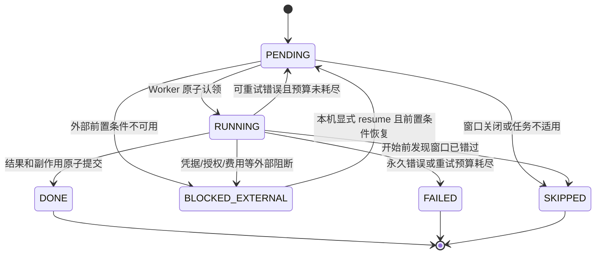

# 工作流状态与可恢复交接

> Doc ID: DOC-0033 · 目录：[DOCUMENT_INDEX](../pmo/DOCUMENT_INDEX.md)
>
> 状态：P03-05 设计契约。应用 Worker、持久化步骤和运行时恢复尚未实现；本文件不代表 Codex 或外部数据源已经接通。
>
> 关联：[调度与事件通知](SCHEDULER.md)、[AI 六角色工作流](AI_WORKFLOW.md)、[API/DTO](API_CONTRACTS.md)、[DB Schema](DB_SCHEMA.md)、[失败与恢复](FAILURE_MODES.md)、[上下文工程规约](../CONTEXT_ENGINEERING.md)。

## 目的与边界

本地长任务必须能说明当前状态、最后一个已提交步骤、下一步输入和失败原因。恢复依据是数据库中的任务记录、不可变输入、已校验步骤产物及来源证据；浏览器进度、进程内存和模型自述都不是持久事实。

以下三种状态必须分开管理：

| 层             | 持久位置                                                                     | 内容                                                                   |
| -------------- | ---------------------------------------------------------------------------- | ---------------------------------------------------------------------- |
| 产品任务       | SQLite `task_runs`                                                           | 调度槽位、规范化输入、总状态、尝试/租约、结果码和错误。                |
| 产品工作流步骤 | SQLite `task_run_steps` 及领域产物                                           | 六角色或其他具名步骤的校验状态、输入摘要、已验证结构化输出和证据引用。 |
| 开发任务交接   | `harness/state/current.md`、`harness/handoffs/<ISSUE_ID>.md` 与 GitHub Issue | Codex 开发上下文的六字段摘要和真实提交/验证证据；不写入产品 SQLite。   |

产品不保存模型隐藏推理、完整提示上下文或秘密作为检查点。只保留后续步骤所需的、通过 schema 与证据引用校验的结构化产物。研究事实、来源记录、报告和事件仍落在各自领域表；步骤记录只保存有版本的输出快照/摘要及其引用。

## 任务身份与状态

任务输入在创建时规范化并计算 SHA-256。持久输入至少引用任务类型、证券/市场范围、计划和规则版本、日历版本、时间窗口、所需来源配置版本及 `asOf`。同一 Idempotency-Key 搭配不同输入 hash 返回 `409 IDEMPOTENCY_KEY_REUSED`；改变输入或规则版本创建新的任务，不覆写旧运行。

`executionStatus` 与 `resultCode`、`verificationLevel`、来源覆盖、新鲜度和 `dataClass` 是独立字段。`DONE` 只表示执行结果已提交；它可以伴随 `PARTIAL_COVERAGE` 或 `NOT_VERIFIED`，不代表事件为空、报告完整或结果可信。

任务状态仅使用 `PENDING`、`RUNNING`、`DONE`、`FAILED`、`BLOCKED_EXTERNAL`、`SKIPPED`。不新增 `RETRYING` 或 `CANCELLED`；退避等待是带 `next_attempt_at` 的 `PENDING`，`SKIPPED_CLOSED`、`MISSED_WINDOW` 等是原因码。状态变化由 Worker/具名本机命令执行，客户端不得 PATCH 状态。

- 瞬时网络/服务错误在固定重试预算内回到 `PENDING`；最多 3 次总尝试（含首次）。超过预算或不可恢复错误进入 `FAILED`。
- 凭据、授权、费用、权限和市场日历来源不可用进入 `BLOCKED_EXTERNAL`，不自动重试，也不推进受影响来源的水位。外部条件恢复后，只有显式本机 resume 命令可将原任务置回 `PENDING`；同一不可变输入和任务 ID 不变，且不重置总尝试预算。预算耗尽后不能再 resume，应以新任务重跑并关联原任务。
- `FAILED`、`DONE`、`SKIPPED` 为终态。用户要从头再跑时以新 Idempotency-Key 创建新任务，旧任务保留并可被新任务引用。
- `SKIPPED_CLOSED`、`MISSED_WINDOW` 以及无有效市场会话时不得创建来源抓取、事件通知或成功水位；不得把过期窗口补跑成实时扫描。
- Fixture 或其下游产物保持 `DEMO_ONLY`，不推进真实来源水位，不进入正式通知或纸面账本。

## 步骤检查点

AI 研究任务依 [AI_WORKFLOW.md](AI_WORKFLOW.md) 的六个串行步骤执行：统筹、情报侦察、市场结构、策略研发、独立风控、模拟计划。每个具名步骤的检查点至少包括：稳定 step key/顺序、任务输入 hash、工作流/schema 版本、尝试序号、状态、起止时间、错误码和经校验输出引用/摘要。

- 新步骤只能在前一步 `SUCCEEDED` 且输出引用通过 schema、证券范围和 evidence ID 校验后开始。
- `SUCCEEDED` 检查点及其输出不可原位改写；恢复时从最后一个已提交成功步骤的下一步继续，不重复已完成步骤。
- 输出快照有 schema version 和 SHA-256。事实/假设/推论仍分别写入研究领域表，不能把无约束 JSON 当事实库。
- 若进程在步骤结果事务提交前中断，则没有成功检查点。恢复后可在预算内使用相同输入重试该步骤；外部模型调用可能因此再次发生，不承诺物理 exactly-once。下游输出、通知和账本只接受一次已提交检查点。
- 步骤已提交但任务总状态尚未完成时，恢复使用该检查点；不能因为总任务仍 `RUNNING` 而重新调用已成功步骤。

源抓取步骤还需记录来源游标/时间范围、分页完整性、来源状态、事件修订引用和本轮 watermarks。完整来源证据、事件、来源水位和该来源步骤输出必须在同一短事务提交。外部网络或 Codex 调用期间不得持有 SQLite 写事务。

## 崩溃恢复协议

Worker 启动后先取得本机单实例执行权，检查数据库和 schema；异常时保留原文件并停止写入。只有到期 `PENDING` 或 lease 已过期且可安全接管的 `RUNNING` 任务可以认领。每次认领使用新的 fencing generation；提交步骤、完成任务或写通知时必须核验 lease owner/generation，过期 Worker 不得覆盖接管后的状态。

恢复顺序：

1. 读取原始任务输入/hash、计划/日历/规则版本、来源水位和已提交步骤；不从 UI、日志截断片段或模型文本推断进度。
2. 重新验证未完成步骤所需的本机服务、数据/日历适用窗口和外部前置条件。若窗口已过期，转 `SKIPPED` / `MISSED_WINDOW`，不回放实时监控。
3. 跳过已成功检查点，从第一个未提交步骤继续。可重试错误沿用同一任务幂等键、输入 hash 和剩余重试预算；来源与规则不符时阻断，不偷偷换输入继续。
4. 根据已保存的事件候选和来源覆盖确定结果码。水位只能说明来源抓取进度；尚未形成最终通知决策的重大事件仍可查询并由后续任务复核，不能因水位前移而消失。
5. 将最终步骤输出、`notification_decisions`、唯一 `notifications` 记录、任务结果引用和任务 `DONE` 状态在一个短事务中提交。提交后重复恢复依靠唯一键得到同一结果。

如果任务因部分来源失败而终止，已完成来源的有效事件和水位可保留；事件候选继续处于待决状态，后续扫描可在来源 SLA 内通知，过期后写入 `EXPIRED_UNNOTIFIED`。任何完整结果的 `NO_NEW_EVENTS` 都要求全部必需来源完整、有效且新鲜。

## 开发上下文六字段交接

Codex 开发任务的六字段交接仍按仓库 [AGENTS.md](../../AGENTS.md) 与 [CONTEXT_ENGINEERING.md](../CONTEXT_ENGINEERING.md) 执行：Objective、Established facts、Applied changes、Verification、Dead ends、Remaining plan。它描述开发 Issue，不等同于应用中 AI 研究的六角色步骤，也不作为产品任务检查点。

恢复开发任务时，先读取原始 GitHub Issue、AGENTS.md、`harness/state/current.md` 和对应 handoff；再核对当前 branch/HEAD、`git status`、实际文件及真实命令日志。摘要只能指向证据，不能替代证据；没有对应文件/提交/退出码就不宣称完成。待处理下一步要指向具体 Issue 与文件/操作，保留原始验收和安全约束。

## 可核验恢复场景

| 中断点 / 输入                                   | 恢复行为                                                                                |
| ----------------------------------------------- | --------------------------------------------------------------------------------------- |
| 一个六角色步骤输出已提交，下一步尚未运行        | 使用已提交输出继续下一步；不重复已成功的模型调用。                                      |
| 进程在步骤输出提交前中断                        | 只重试该未提交步骤，沿用固定输入和预算；不创建报告或副作用。                            |
| 来源水位和事件候选提交后，通知选择前崩溃        | 候选仍从事件/步骤记录可查询；恢复或后续扫描重新排序，最终通知唯一且不漏。               |
| 通知和任务完成事务提交后立刻崩溃                | 任务已 `DONE`，重复投递由任务/通知唯一键去重，不产生第二条提醒。                        |
| 相同计划槽位被重复 Worker 触发                  | 唯一计划幂等键只认领一个 `task_runs`；其他触发读取同一任务。                            |
| TSE 午休/周末，或纽约 DST 切换导致 UTC 偏移变化 | 依据对应市场的当地会话日历；午休/休市不运行，DST 下两个不同 UTC 槽位不碰撞。            |
| 扫描时无凭据/来源，之后用户修复本机条件         | 原任务进入 `BLOCKED_EXTERNAL`，不自动重试；显式 resume 前检查依赖，不推进缺失来源水位。 |
| 仅有隔离 Fixture                                | 步骤、报告和通知展示均为 `DEMO_ONLY`；不污染真实来源水位、事件通知或账本。              |
| 新开发上下文恢复一个未完成 Issue                | 按六字段 handoff 读取后核验当前 Git、文件和验证日志；未证实内容保持未证实。             |

实际自动恢复、SQLite 崩溃一致性、fencing 和重放回归由 P04/P05/P08/P11/P12 实现与验证；本 Issue 只定义契约。
