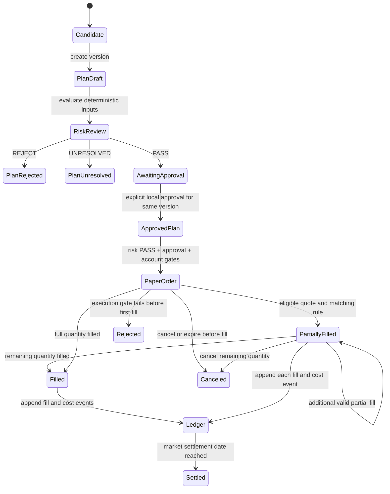

# FR-Trade — 纸面交易、回测与风控契约

> 状态：P01-03 需求基线；本文定义拟实现和验收的行为，不代表纸面交易、回测或行情接口已经实现。对应 [Issue #22](https://github.com/OYLPY/stock-monitor/issues/22)。
>
> 上位约束：[PRD](PRD.md)、[需求索引](REQUIREMENTS_INDEX.md)、[用户用例](USE_CASES.md)。本产品是本机即开即用工具，不提供应用登录、注册或用户管理。

## 范围与不变量

- 仅支持美国/日本上市普通股票及非杠杆 ETF 的现金多头纸面研究；不支持保证金、杠杆、卖空、期权、券商账户或真实订单。
- 纸面账户必须由本地使用者显式初始化，初始余额固定为 1,000,000 JPY；系统不得假造初始化之前的资产、持仓、订单或收益。
- 每笔新计划必须经过确定性风控，计划损失不高于可核验当期权益的 2%；当期权益相对账户历史权益峰值回撤达到 20% 时，禁止新增头寸。固定阈值不得由策略、AI 或用户输入放宽。
- 回测是可复现的历史计算实验，不是模拟账户成交、真实绩效或收益承诺；Fixture 结果始终是 `DEMO_ONLY`。
- 研究候选、纸面计划、风控裁决、本地批准、纸面订单、模拟成交和账本事件是不同对象；任何前项均不得自动推导出后项。
- 本 Issue 定义业务契约。数据库 Schema/迁移、接口 DTO、具体撮合算法、供应商成本表和完整运行测试由 P02/P03/P04/P09/P10/P12 落地；此处不假定尚未选定的数据商或收费标准。

## 需求编号

| ID           | 需求                                                                                                                                                                                                         | 关联 RQ / 用例                              |
| ------------ | ------------------------------------------------------------------------------------------------------------------------------------------------------------------------------------------------------------ | ------------------------------------------- |
| FR-Trade-001 | 研究候选与纸面计划分离；候选和未提交的计划不预留现金、不下单、不产生成交或账本变化。                                                                                                                         | RQ-019、RQ-020；UC-04、UC-07                |
| FR-Trade-002 | 计划按不可变版本记录；确定性风险裁决和本地使用者批准各自绑定到同一版本，计划变更后必须重新裁决和批准。只有二者均有效且通过时才可创建纸面订单。                                                               | RQ-019、RQ-020；UC-07                       |
| FR-Trade-003 | 仅接受有可信分类与交易单位数据的美国/日本普通股票、非杠杆 ETF 和现金多头；无法分类或属于禁止资产时拒绝计划。                                                                                                 | RQ-002、RQ-018；UC-07                       |
| FR-Trade-004 | 纸面账户只在明确初始化时建立 1,000,000 JPY 账本起始事件；初始化前不显示推算余额，已有账本不可通过再次初始化重置。                                                                                            | RQ-015、RQ-021；UC-07                       |
| FR-Trade-005 | 可核验权益由结算现金、未结算应收/应付、持仓市值和相关负债按有效报价与 FX 换算至 JPY；缺任何必需估值时返回 `UNRESOLVED` 并阻止新增风险。                                                                      | RQ-016、RQ-017、RQ-022；UC-07               |
| FR-Trade-006 | 单笔计划风险包括入场与止损执行假设、费用、滑点及 FX 换算成本；股数必须按交易单位向下取整，并同时满足 2% 风险预算与已结算可用现金。                                                                           | RQ-016、RQ-022；UC-07                       |
| FR-Trade-007 | 最大回撤以初始化后的已核验 JPY 权益历史峰值计算；回撤 `>=20%` 时风险裁决拒绝所有新增头寸，不强制平仓。                                                                                                       | RQ-017、RQ-019；UC-07                       |
| FR-Trade-008 | 报价、FX、证券分类、交易单位、费用模型和交易日历须携带来源/时间/版本并满足其有效性规则；缺失、过期、相互冲突或不能复核时不得通过风控或模拟成交。                                                             | RQ-016、RQ-019、RQ-022；UC-07、UC-08        |
| FR-Trade-009 | 订单仅由本地模拟器处理；模拟成交必须符合已记录的确定性成交规则和合格行情证据，模拟订单状态不可被描述为真实订单或成交。                                                                                       | RQ-018、RQ-020；UC-07                       |
| FR-Trade-010 | 账本只追加事件，可由事件重放重建现金、持仓和权益；重复成交事件不得重复记账，纠错以可追溯冲正事件表达。                                                                                                       | RQ-020、RQ-021；UC-07、UC-10                |
| FR-Trade-011 | 回测必须记录完整运行输入并按时间顺序计算；不得使用当时不可知的未来数据或在生成信号的同一收盘价成交。缺少可复现数据/成本时结果为 `NOT_VERIFIED`。                                                             | RQ-013、RQ-022；UC-08                       |
| FR-Trade-012 | 策略的样本外稳定性、扣费后收益、最大回撤、成交可行性、跨环境稳健性五项各按 1–5 评分；每项必须有证据，证据不足不评分；总分 `>=18/25` 仅标记为验证候选。                                                       | RQ-014；UC-04、UC-08                        |
| FR-Trade-013 | 离线、无凭据或无当前外部行情时仍可查看本地账本和已保存材料；合法历史数据可继续用于标记为 `HISTORICAL` 的可复现回测。缺少所需历史数据时不得生成已验证回测。Fixture 仅能进入隔离的演示结果并标记 `DEMO_ONLY`。 | RQ-011、RQ-018、RQ-028；UC-01、UC-07、UC-08 |

## FR-Trade-001–003 — 候选、计划、批准和资产范围

1. **研究候选**只表达待验证的证券/策略假设，不是交易指令。
2. **纸面计划**必须绑定证券、方向、数量、入场/退出/止损规则、计划生成时间、报价/FX/交易单位/成本证据及版本。计划可保存为草稿；草稿没有资金或账本副作用。
3. 风控裁决是确定性结果：`PASS` 表示所引用输入满足固定门槛；`REJECT` 表示已知触犯门槛；`UNRESOLVED` 表示必需输入不足或无效。AI 输出不能替代、改写或绕过裁决。
4. **本地批准**是使用者对特定计划版本的显式确认，不是风控通过，也不要求登录或维护用户身份。版本变化后旧批准和旧裁决不可复用。
5. 只有风险 `PASS`、批准有效、回撤门禁开放且可用现金/行情仍有效时，模拟器才可接受新纸面订单。`>=18/25` 的策略验证候选状态不构成订单批准。
6. 证券必须可确定为美国/日本上市普通股票或非杠杆 ETF，方向仅为多头。无法证明类别、市场、杠杆属性或数量单位时返回 `UNRESOLVED`；明确为杠杆 ETF、期权、卖空或保证金交易时 `REJECT`。

## FR-Trade-004–008 — 权益、风险、回撤与资金可用性

### 账户权益

所有风险和账户比较以 JPY 为基准币种。时点 `t` 的权益为：

```text
equityJPY(t) = Σc [settledCash(c) + unsettledReceivables(c) - unsettledPayables(c)] × FXJPYper(c,t)
             + Σi [positionQty(i) × verifiedMark(i,t) × FXJPYper(quoteCurrency(i),t)]
             - accruedLiabilitiesJPY(t)
```

- 初始 JPY 现金为 1,000,000；未成交订单的预留金额减少该币种的**可用现金**，不重复扣减权益。
- 买入可用现金按币种分别计算：该币种已结算余额减去有效订单预留及应付费用。未结算卖出款可计入权益中的应收款，但不可用于新的买入。
- 外币资产/现金需要与估值时点相匹配且有效的 FX 证据。不能用缺失或过期 FX 将 USD 等余额默认当作 JPY。
- 每个持仓的报价、FX 或费用负债不可核验时，整体权益为 `UNRESOLVED`；不得只剔除不利或缺失资产后继续批准新仓。
- 计算使用十进制定点/精确十进制语义；实现阶段定义货币最小单位的记账舍入。风险换算到 JPY 向上取整，风险预算向下取整，不能因舍入放宽门槛。

### 单笔计划风险与数量

```text
riskBudgetJPY = floorJPY(verifiedEquityJPY × 0.02)
plannedLossJPY(q) = ceilJPY(Σc [q × max(0, assumedEntryFill(c) - assumedStopFill(c))
                                + entryFees(c,q) + exitFees(c,q) + otherApplicableCosts(c,q)]
                                × conservativeFXJPYper(c)
                              + FXConversionCostsJPY(q))
```

`assumedEntryFill` 和 `assumedStopFill` 必须体现计划中明确的入场/止损价格及滑点假设；`otherApplicableCosts` 包括适用的交易所/监管费用和税费。成本模型需版本化且给出来源、生效范围和采集/更新时点；不能以零费用代替未知费用。

```text
qMax = max(q ∈ validTradingUnitMultiples:
           plannedLossJPY(q) <= riskBudgetJPY
           AND purchaseCommitment(q) <= availableSettledCashInRequiredCurrencies)
```

若没有满足风险、现金和交易单位条件的正数量，则不得建立新仓。单笔风险门槛不构成未定义的组合总风险/总持仓上限；V1 不得在实现中臆造此类阈值。

### 峰值回撤门禁

```text
peakEquityJPY(t) = max(verifiedEquityJPY(s)) for initializationTime <= s <= t
drawdown(t) = max(0, (peakEquityJPY(t) - verifiedEquityJPY(t)) / peakEquityJPY(t))
```

`drawdown >= 0.20` 时阻断新头寸，等号属于阻断范围。权益/峰值无法核验或峰值无效时返回 `UNRESOLVED` 并阻断。该门禁不自动平仓；风险降低或退出操作仍可执行。权益恢复后只有在重新计算得出 `drawdown < 0.20` 且所有其他门禁通过时，才允许评估新计划。

### 交易单位、现金币种与结算

- V1 数量必须是证券交易单位的整数倍；美国股票按整股处理，日本国内普通股票按 100 股处理，日本 ETF 按对应证券的实际单位处理。未知单位阻断下单，不得统一假定 ETF 为 100 股。
- 账户现金分币种记录。买入非 JPY 证券前，必须已有足额该币种已结算现金，或由显式、可审计的模拟 FX 转换产生；不得隐式借入、透支或在计划里假定自动换汇。
- 未成交订单需保留资金，不能被其他订单重复使用；撤单释放未成交部分预留。未结算卖出款不能资助后续买单。
- 结算日按可版本化的市场营业日历计算，不硬编码单一 T+ 偏移。本文于 2026-11-15 核对的规则来源为：美国适用交易的 T+1 标准结算（SEC 合规日 2024-05-28）和 TSE 普通股票/债券普通交易 T+2；实现前须重新核验对应市场、产品和有效日期，模拟规则不代表任何券商账户的实际结算。

## FR-Trade-009–010 — 模拟订单、成交与账本



- A paper order is a local simulator object only. `PENDING`, `PARTIALLY_FILLED`, `FILLED`, `CANCELED`, `EXPIRED`, and `REJECTED` describe simulator state, not broker state. Filled quantity is never discarded when an unfilled remainder is canceled or expires.
- Each simulated fill requires an eligible, timestamped quote, valid market/session and FX/cost inputs, and a deterministic matching rule defined in P10. Missing/stale/conflicting data cannot trigger a fill. Historical/Fixture data cannot create a non-demo paper fill; delayed data can do so only under a separately documented execution policy and with its delay visible.
- Every fill records plan version, order ID, fill ID, quantity, price, quote/source timestamp, market timestamp, currency, cost model version and settlement date. Duplicate fill IDs are idempotent.
- The ledger records initialization, FX conversions, order reservations/releases, fills, transaction costs, settlements, and supported corporate actions as append-only events. Current balance/holdings are projections of those events; corrections use linked reversal/correction events, never an edit of prior history.

## FR-Trade-011–013 — 回测、评分与缺数据状态

### 回测可复现和防未来函数

每次运行至少绑定策略代码/版本及参数、数据集/来源和有效时间范围、复权口径、FX 数据、费用/滑点模型版本、交易单位、样本内/外边界、成交规则和计算引擎版本。相同版本输入重放必须得到相同订单序列、现金/持仓序列和指标；输入不完整时报告 `NOT_VERIFIED`，不能填补为零成本或引用未来数据。

- 每个信号只可使用该时点已经可得的行情/公司行动/FX 信息。基于日线收盘价计算的信号最早在下一可交易 bar/时点执行，不允许同一根 bar 的收盘价成交。
- 若单根 OHLC bar 同时触发止损和止盈而无更细粒度数据，采用对策略不利的止损优先解释，或将该交易/结果标记 `NOT_VERIFIED`；不得挑选更有利的路径。
- 回测必须扣除版本化的佣金、交易所/监管费用、适用税费、滑点和换汇成本。缺少必要输入或不能复算时，不生成已验证收益、胜率或评分。
- Fixture 可用于验证计算路径，但所有结果明显标为 `DEMO_ONLY`，不得合并进真实数据报告或纸面账本。

### 五维验证候选评分

| 维度         | 必须提供的证据                                      |
| ------------ | --------------------------------------------------- |
| 样本外稳定性 | 样本外期间及其相对样本内的结果/变化                 |
| 扣费后收益   | 含全部已声明费用、FX 和滑点后的收益序列             |
| 最大回撤     | 按可复现权益曲线的历史峰值回撤                      |
| 成交可行性   | 交易单位、可用成交数据、费用/滑点假设与无法成交情形 |
| 跨环境稳健性 | 明确的市场/时期/参数环境及其可比较结果              |

每维采用 1–5 分，必须附对应结果与评分依据；缺少证据时不评分，不以零分或 AI 主观判断伪装测量。总分 `>=18/25` 只能命名为**验证候选**，不等于风控通过、批准或订单许可。具体分数阈值/评分细则由 P09 基于可验证数据确定，本 Issue 不臆造阈值。

## 运行时验收案例

以下 AC 是 P09/P10/P12 的实现验收输入，不代表本 Issue 已运行的交易代码测试。

| ID         | Given / When                                                                    | Then                                                                                                                                     |
| ---------- | ------------------------------------------------------------------------------- | ---------------------------------------------------------------------------------------------------------------------------------------- |
| AC-TRD-001 | 账本未建立；使用者显式初始化                                                    | 只追加一条 1,000,000 JPY 初始资金事件；初始化前没有推算余额、历史持仓或收益。                                                            |
| AC-TRD-002 | 已有初始账本；再次执行初始化                                                    | 拒绝重置，不创建重复本金、不改动原账本。                                                                                                 |
| AC-TRD-003 | 提交美日上市普通股票/非杠杆 ETF、杠杆 ETF、期权、卖空或保证金计划               | 仅分类可核验的前两类多头计划继续评估；禁止类返回 `REJECT`，未知类别返回 `UNRESOLVED`。                                                   |
| AC-TRD-004 | 计划版本风险为 `PASS` 但尚无本地批准；或已批准计划随后被编辑                    | 不产生订单；修改后的新版本必须重新风控和批准。                                                                                           |
| AC-TRD-005 | 可核验权益为 1,000,000 JPY，现金/单位/费用均有效                                | 计划损失恰为 20,000 JPY 可通过 2% 门槛；20,001 JPY 被拒绝，且不得产生订单或账本成交。                                                    |
| AC-TRD-006 | 新计划所需的权益、持仓报价、FX、费用、交易单位或当前市场状态缺失/过期/冲突      | 裁决为 `UNRESOLVED` 并阻止新订单；不将缺失值当作零或沿用过期值。                                                                         |
| AC-TRD-007 | 权益历史峰值 1,000,000 JPY，当前可核验权益 800,000 JPY；再比较 800,100 JPY      | 20.00% 时阻断新头寸；19.99% 时仅解除回撤这一项阻断，仍须通过其余门禁；不得强制平仓。                                                     |
| AC-TRD-008 | 计划通过 2% 风险门槛，后续开盘跳空使模拟止损成交价劣于计划止损价                | 按真实的模拟成交价记录实际损失并提示超过计划风险；不得声称 2% 是最坏损失保证或篡改成交价。                                               |
| AC-TRD-009 | 日本普通股票计划量不是 100 股的倍数，或 ETF 单位未知                            | 拒绝非法数量；ETF 单位未知时 `UNRESOLVED`，不假设所有 ETF 同单位。                                                                       |
| AC-TRD-010 | 成本模型未提供必要的买卖费用/滑点/适用税费                                      | 风控/回测不通过为 `PASS`，回测结果 `NOT_VERIFIED`；成本信息齐全时结果扣除对应成本。                                                      |
| AC-TRD-011 | 账户只有 JPY 现金，计划买入 USD 计价股票；没有有效 FX 转换事件                  | 不能产生 USD 购买力、透支或模拟成交；有效且显式的模拟换汇事件应同时记录汇率、来源、时间和成本。                                          |
| AC-TRD-012 | 有未成交订单预留或尚未结算的卖出款；提交第二笔买入                              | 预留现金不可重复使用；未结算应收款不计入可买现金；按版本化市场日历结算后再成为已结算现金。                                               |
| AC-TRD-013 | 订单有风险 `PASS`、有效本地批准但无合格行情/撮合条件；随后出现可核验模拟报价    | 前者无成交；后者只生成满足确定性撮合规则的模拟状态/成交，绝不发起证券公司或交易所请求。                                                  |
| AC-TRD-014 | 同一 fill ID 重放两次，或账本从同一事件序列重建                                 | 现金、持仓、费用和权益均不重复变化；重放前后投影完全一致。                                                                               |
| AC-TRD-015 | 有 2026-11-15 核对的当前结算规则引用及模拟业务日期                              | 美股普通交易使用版本化 T+1 日历，TSE 普通股票/债券普通交易使用版本化 T+2 日历；结算规则不可用时不能提前释放卖出款。                      |
| AC-TRD-016 | 日线收盘时生成信号；或同一 OHLC bar 同时触及止损和止盈                          | 不在该收盘价成交；相同 bar 歧义采用止损优先或 `NOT_VERIFIED`。                                                                           |
| AC-TRD-017 | 相同策略版本、参数、数据、FX、成本与撮合规则重跑；或其中一项缺失                | 完整输入应得到完全相同的订单/资金/指标序列；缺失时 `NOT_VERIFIED`，Fixture 永远为 `DEMO_ONLY`。                                          |
| AC-TRD-018 | 五维评分证据齐全并总分 18/25，或任一维证据不足                                  | 前者只标记“验证候选”，不能自动批准/开仓；后者不输出完整评分或已验证结论。                                                                |
| AC-TRD-019 | 离线、无 Codex 凭据且无当前外部行情；分别提供合法缓存历史数据和无可用数据的场景 | 合法缓存数据可复现历史回测并标记 `HISTORICAL`；缺数据时为 `NOT_VERIFIED`。不得伪造 AI/当前行情/风险通过/成交；Fixture 标记 `DEMO_ONLY`。 |

## 官方市场规则来源

以下来源于 2026-11-15 核对；P03/P09/P10 实现时须再次核对有效日期并保存规则版本：

- [JPX 国内股票交易单位](https://www.jpx.co.jp/english/equities/trading/domestic/03.html)：日本国内普通股票交易单位为 100 股。
- [JPX ETF 交易规则](https://www.jpx.co.jp/english/equities/products/etfs/trading/index.html)：ETF 的交易单位依产品而异，必须读取具体证券单位。
- [JPX 滚动结算说明](https://www.jpx.co.jp/glossary/ra/474.html)：TSE 普通股票及债券普通交易通常在交易日后第二个营业日（T+2）结算。
- [SEC T+1 FAQ](https://www.sec.gov/exams/educationhelpguidesfaqs/t1-faq)：美国受适用规则覆盖交易的 T+1 合规日为 2024-05-28；细分适用性仍须按规则日历核验。
- [SEC Investor.gov 止损订单说明](https://www.investor.gov/introduction-investing/general-resources/news-alerts/alerts-bulletins/investor-bulletins-15)：止损价是触发价，不保证成交价；流动性与快速价格变化可能造成显著偏差。该说明于 2026-08-18 更新。

## P01-03 交接

- 本文件确定产品需求、公式、状态和运行时 AC，不包含模拟交易或回测实现。
- 数据源/费用授权和实时行情未验证时必须如实为 `NOT_VERIFIED` / `BLOCKED_EXTERNAL`；不得用 Fixture 代替真实市场证据。
- P03 负责数据库与 API 详细设计；P09 负责回测实现及指标；P10 负责确定性风控、模拟订单/成交和账本；P12 对相关 AC 运行实现级验证。
