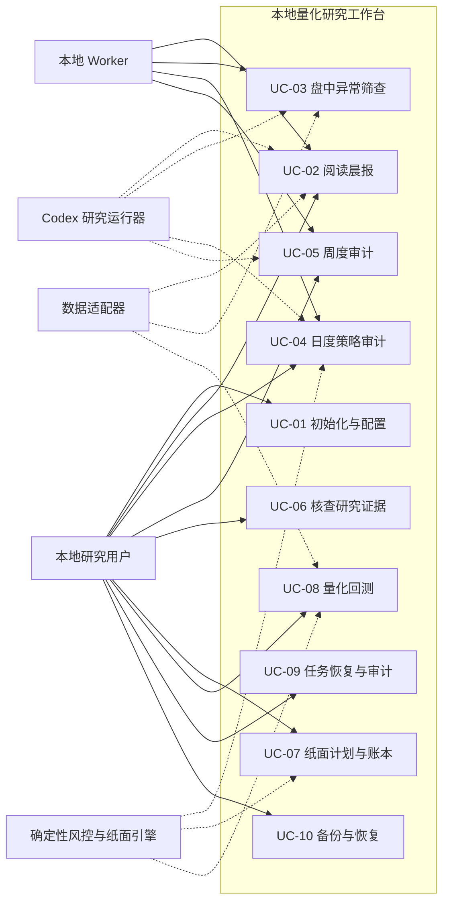
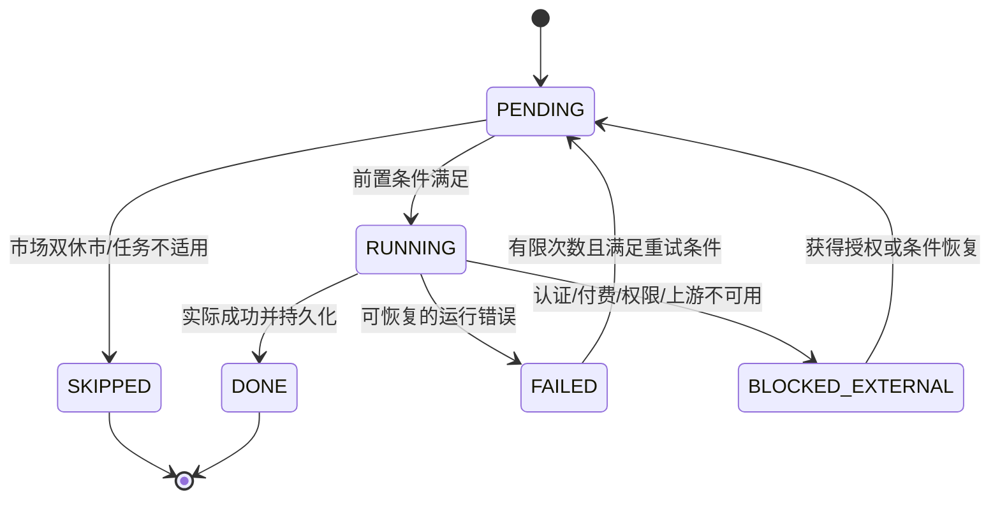

# P01-01 用户用例与交互流程

> 产品范围依据：[PRD.md](PRD.md)。用例 ID 在本文件内稳定，后续设计/测试使用相同编号；以下均是**拟实现和应验收行为**，不表示现已实现。

## 参与者

- **研究用户（Owner）**：唯一业务用户，可查看、配置、审核纸面研究与账户，但不能真实下单。
- **本地 Worker**：按可配置计划运行晨报、盘中扫描、日审计、周审计，保存运行日志与通知历史。
- **市场数据适配器（Provider Adapter）**：获取允许使用的美日股行情、公告、经济日历及来源信息。
- **Codex 研究运行器（AI Runner）**：生成有证据链接的结构化研究结果，不承担实际价格/资金核算。
- **确定性风险与纸面引擎**：唯一可计算并提交风险决定、模拟账本事件的代码路径。

## 业务用例图（Mermaid）

箭头表示“触发或向用例提供能力”，不是网络协议；不意味着 Provider、AI 可以跳过可信边界直接写账本。

## UC-01 首次启动、本地配置

| 项目 | 内容 |
|---|---|
| 主参与者 | Owner |
| 触发 | 用户首次访问 `127.0.0.1` 本地应用 |
| 前置 | 本机已启动 Next.js；数据库可以新建或显示初始化错误 |
| 输入 | 本地用户偏好、选用的数据源、可选 API 凭据配置、模拟账本是否初始化 |
| 正常输出 | Dashboard 可打开；配置来源与数据状态清晰；不需要注册云端账户或券商账户 |
| 异常路径 | Codex 未认证：显示 AI_UNAVAILABLE；数据源无密钥：显示 BLOCKED_EXTERNAL；SQLite 不能初始化：不建立假账本并记录错误 |
| 验收 | Given 本地服务可运行且无 API 凭据；When 首次打开；Then 可浏览应用空状态并看到“数据未接入”，不会出现伪价格/收益 |

## UC-02 每日晨报

| 项目 | 内容 |
|---|---|
| 主参与者 | Owner 或 Worker |
| 触发 | 手动点击生成，或按本机时区计划开始任务 |
| 前置 | 任务存储可写；行情来源可部分或全部不可用 |
| 输入 | 美日最近**已完成**交易日、历史行情、宏观/公司事件、未来 24 小时日历、研究候选、账本存在性 |
| 正常输出 | 五行市场摘要、汇率/利率背景、已发生/未发生事件、至多3策略、证据与缺口、风控意见及一句话决定 |
| 异常路径 | 美国交易时段未结束：只能展示上一个完成交易日；周末/节假日：说明休市；没有行情：NOT_VERIFIED；Codex 失败：保存失败执行记录 |
| 验收 | Given JST 周日及未接入美股行情；When 发起晨报；Then 日美最新完成日期正确、不声称周末已收盘价格，不填造股票收益 |

## UC-03 盘中重大异常筛查

| 项目 | 内容 |
|---|---|
| 主参与者 | Worker（Owner 可手动请求同样条件校验） |
| 触发 | 计划扫描时刻，且任一市场处于常规交易时段 |
| 前置 | 能判断当前各市场真实交易状态，拥有上次观察的持久化水位 |
| 输入 | TSE/NYSE/Nasdaq 时段、上次观察、最新可信来源、市场事件与行情快照、候选策略失效因素 |
| 正常输出 | 最多3个经证据支持的新重大事件（市场、标的、当地时间、事实、影响、触发/失效、风险与动作）；否则不发送提醒 |
| 异常路径 | 双市场休市/日本午休且美国未开：SKIPPED_CLOSED；旧事件：DEDUPED；行情过期：DATA_STALE；来源不可用：SOURCE_UNAVAILABLE（不等于“市场平稳”） |
| 验收 | Given JST 周日；When 手动/定时触发；Then 不进行盘中扫描也不发提醒；Given 相同新闻指纹再次出现；Then 不重复告警 |

## UC-04 每日研究与策略计划审计

| 项目 | 内容 |
|---|---|
| 主参与者 | Owner 或 Worker |
| 触发 | 用户手动审计或每日任务时间 |
| 前置 | 至少能读取已保存研究候选；可以没有回测、行情或账本 |
| 输入 | 策略假设、实际历史数据（如有）、交易成本、波动、风险预算与账户验证状态 |
| 正常输出 | ≤3个不同逻辑策略、对手盘和经济优势假设、入出场/止损、数据来源、五维验证信息、风险官批准/否决 |
| 异常路径 | 无回测：五维不评分；无账本：不得计算持仓及权益；AI给出伪回测/伪引用：REJECTED_UNVERIFIED；超过2%：RISK_REJECTED |
| 验收 | Given 无可复算OHLCV；When 执行审计；Then 可以提出研究假设但不出现具体样本外收益率或“已成交” |

## UC-05 每周策略审计

| 项目 | 内容 |
|---|---|
| 主参与者 | Owner 或 Worker |
| 触发 | 每周计划任务或手动 |
| 前置 | 历史研究/执行日志可查；缺记录时可降级 |
| 输入 | 上一周期的实验、市场事件、风险审批、可核查模拟账本及未解决假设 |
| 正常输出 | 证据变化、策略升级/降级理由、数据缺口、失败原因及下一周待检验事项 |
| 异常路径 | 无模拟成交：不展示周盈亏；无回测/数据：保持NOT_VERIFIED；资料缺失：显示审计无法得出结论 |
| 验收 | Given 无持久账本；When 生成周度审计；Then 不能推算周收益或账户净值 |

## UC-06 原始证据核查

| 项目 | 内容 |
|---|---|
| 主参与者 | Owner |
| 触发 | 在晨报/事件/策略详情点击引用 |
| 前置 | 记录包含来源或不可验证标记 |
| 输入 | 事件ID、来源URL、来源时间、采集时间、证券、币种与研究结论 |
| 正常输出 | 来源详情和可点击原文、发布时间与采集时间及模型推断/事实分类 |
| 异常路径 | URL失效：保留原始来源标识但标记不可用；冲突价格：保留两个来源并提示待确认；AI未提供引用：不能显示 VERIFIED |
| 验收 | Given AI 虚构了不可访问的证券公告链接；When 校验证据；Then 显示 UNVERIFIED，不提升为可靠事实 |

## UC-07 纸面计划、风控、模拟账本

| 项目 | 内容 |
|---|---|
| 主参与者 | Owner；风险与账本操作由确定性引擎执行 |
| 触发 | 用户决定初始化纸面账户并提出纸面交易计划 |
| 前置 | 账本不存在或可核实；市场/货币元数据与报价证据可用 |
| 输入 | 显式初始 1,000,000 JPY、证券、方向（仅现金多头）、计划价格/止损/费用、外汇汇率、账户权益 |
| 正常输出 | 计划及风险审批记录；通过后进入受控模拟订单状态，**只有撮合规则和可信数据满足时**才能写模拟成交事件 |
| 异常路径 | 未初始化账本：拒绝开仓；单笔损失预算>当前权益2%：拒绝；峰值回撤≥20%：禁止新仓；报价或FX过期：拒绝；重复成交ID：不重复扣款 |
| 验收 | Given 初始账本1,000,000 JPY、单笔预计最大损失20,001 JPY；When 审批；Then 立即否决且账本没有订单成交变化 |
| 特别说明 | “2%”为可核验的**计划风险**硬门禁，不承诺跳空、流动性冲击下市场真实最坏损失一定≤2%。V1不连接券商 |

## UC-08 历史量化回测

| 项目 | 内容 |
|---|---|
| 主参与者 | Owner |
| 触发 | 选择策略和历史数据并运行回测 |
| 前置 | 具备可复算的、许可允许的历史数据或显著标记的 Fixture |
| 输入 | 历史复权OHLCV、策略参数、汇率、手续费/滑点、采样区间、样本内/外切分 |
| 正常输出 | 可重复运行的回测报告、交易次数、风险/收益/成本/回撤及证据标签；满足统计证据后才评分 |
| 异常路径 | 样本不足：NOT_VERIFIED；缺2020/2022数据：压力测试待验证；检测未来函数：拒绝公布合格结论；Fixture 结果：DEMO_ONLY |
| 验收 | Given 仅有测试用的合成价格序列；When 回测；Then 可以输出“测试算例”但不得标记为真实历史绩效 |

## UC-09 任务异常与恢复

| 项目 | 内容 |
|---|---|
| 主参与者 | Worker、Owner |
| 触发 | 本地服务重启、网络断连、AI超时、设备从休眠恢复、用户查看任务日志 |
| 前置 | 任务状态和幂等键已持久化 |
| 输入 | 最近一次任务状态、开始/完成时间、上次成功水位、失败原因、是否仍在交易时段 |
| 正常输出 | 可审计的运行历史；可安全重试任务；任务编号不变且无双重账本副作用 |
| 异常路径 | 错过交易时间：仅记错过/已跳过，不倒填“当时在线监测”；额度耗尽：BLOCKED_EXTERNAL；状态不完整：安全校验后恢复 |
| 验收 | Given Worker 在通知前崩溃；When 重新启动；Then 依事件指纹和通知历史保证不重复告警 |

## UC-10 备份与恢复

| 项目 | 内容 |
|---|---|
| 主参与者 | Owner |
| 触发 | 用户导出本地数据，或在新环境/原环境恢复 |
| 前置 | 可读取本地数据库；准备一个备份目标文件或符合版本规范的备份 |
| 输入 | SQLite数据、schema版本、账本事件、任务历史、来源元数据 |
| 正常输出 | 完整备份文件、校验/恢复报告、数据一致性结果 |
| 异常路径 | 版本不兼容/备份损坏：拒绝覆盖现有数据库；备份缺失：显示明确错误；凭据不应无提示包含在导出中 |
| 验收 | Given 一份已知测试账本；When 备份并恢复到空目录；Then 资金流水、权益与任务历史一致；故意破坏备份时不可覆盖旧数据 |

## 通用任务状态与结果区分

`SKIPPED_CLOSED`、`DATA_STALE` 等是面向事件/诊断的原因码，不一定是任务顶层状态。具体状态机与数据库持久化契约在 P03-05 细化。

## 审计与需求追踪

| 核心场景 | 需求域 | 后续明细 Issue | 系统测试阶段 |
|---|---|---|---|
| UC-01 | F-OPS / F-UX | P01-04, P05, P06 | P12-03 |
| UC-02 | F-BRIEF | P01-02, P08-04, P11-04 | P12-03 |
| UC-03 | F-WATCH | P01-02, P07-01, P11-03 | P12-01, P12-02 |
| UC-04 | F-DAILY / F-RESEARCH | P01-02, P08-02, P09-06 | P12-04 |
| UC-05 | F-WEEKLY | P01-02, P11-04 | P12-03 |
| UC-06 | F-RESEARCH | P01-02, P08-03 | P12-02 |
| UC-07 | F-RISK / F-PAPER | P01-03, P10 | P12-01, P12-02 |
| UC-08 | F-BACKTEST | P01-03, P09 | P12-04 |
| UC-09 | F-SCHED | P01-02, P11 | P12-05 |
| UC-10 | F-OPS | P01-04, P05-05 | P12-02, P12-05 |
